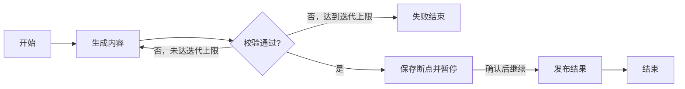

# J-Workflow

一个以 Java 实现的工作流执行引擎，目标是支持**有环工作流执行、断点保存，以及工作流暂停与继续**。

项目在现有 Java 工作流引擎上扩展调度和状态管理，让工作流能够表达循环处理、多轮校验、人工确认和长时间运行等业务。

当前改造以**保留原 DSL、复用原节点执行器，通过条件分支控制循环**为方向，分阶段实施暂停、持久化与恢复。执行依据见 [原引擎最小改造实施计划](docs/原引擎最小改造实施计划.md)，源码结论与实际交付见 [P0 兼容基线](docs/P0兼容性基线与验收记录.md)、[P1 原执行器复用与激活隔离](docs/P1原执行器复用与激活隔离验收记录.md) 和 [P2 原 DSL 有环执行与分支路由](docs/P2原DSL有环执行与分支路由验收记录.md)。

> 既有独立 V2 是另一条实验实现，其设计、使用与验收文档已归档到 [历史实验 V2](docs/history/v2/README.md)。P2 已通过内部 Java 入口 WorkflowGraphExecutor 支持原格式分支循环；原 HTTP 执行路径当前仍有 DAG 限制，暂停和持久化恢复尚待后续阶段实现。

## 为什么重新设计

现有引擎将工作流限制为有向无环图（DAG），并按节点维护一次执行状态。这种模型适合一次性任务编排，但难以直接表达以下需求：

- 生成内容后进行校验，不通过时返回生成节点，直到满足条件。
- 根据运行结果反复调用工具，动态决定下一步操作。
- 执行到指定位置后暂停，等待人工确认或外部输入。
- 保存执行进度，在服务重启或任务中断后从已提交的断点恢复。

新引擎将围绕“节点可以多次执行、运行状态可以持久化、执行过程可以暂停和恢复”建立统一的执行模型。

## 核心目标

### 有环工作流执行

支持带条件回边的有环工作流，使同一节点能够在一次工作流运行中被多次执行。

- 为每次节点执行创建独立的执行实例，分别记录输入、输出和状态。
- 区分业务循环与失败重试，分别管理循环轮次和重试次数。
- 使用原分支节点控制循环出口，增加每节点激活数、总步数和运行时长保护。
- 保存每次执行的输入输出历史，明确原变量引用与每次结果提交的语义。
- 明确分支与汇聚规则，避免循环和并行组合时发生错误调度。

### 断点保存

将工作流的执行进度持久化，使恢复过程能够依据已提交状态继续推进。

计划保存的内容包括：

- 工作流运行标识及其绑定的定义版本。
- 节点执行实例、执行状态和重试记录。
- 节点输入输出、变量及循环作用域。
- 待执行任务、分支汇聚状态和外部事件等待信息。

断点以节点执行结果的提交边界为基础。恢复时保留已提交的执行结果；中断时尚未提交的调用需要按恢复策略处理，外部副作用通过幂等机制防止重复生效。第一阶段不保存线程栈，也不支持从节点内部任意代码行恢复。

### 暂停与继续

支持主动暂停，以及执行到指定断点或等待外部输入时暂停。

- 暂停后停止调度新的节点执行实例。
- 对正在执行的节点，第一阶段采用协作式暂停：等待其完成并提交结果，再进入已暂停状态。
- 暂停确认前持久化执行进度，确保继续执行有据可依。
- 继续时加载运行状态，从待执行位置推进，保留已完成的结果。
- 对重复的暂停、继续请求提供幂等处理。

暂停不等同于取消，也不意味着强制中断正在进行的外部调用。

## 执行示例

下面是新引擎计划支持的流程：校验不通过时重新生成，校验通过后暂停等待确认，再继续发布。

每一轮“生成内容”都拥有独立的执行记录。等待确认期间保存运行状态，收到继续指令后进入发布节点。

## 设计方向

| 组成 | 职责 |
| --- | --- |
| 工作流定义 | 描述节点、连线、路由条件、循环和断点配置，绑定明确的版本 |
| 工作流运行实例 | 管理一次运行的生命周期、执行预算和整体进度 |
| 节点执行实例 | 表示节点的一次逻辑执行，独立记录状态与结果 |
| 调度器 | 通过事件与任务队列推进控制流，支持重复激活节点 |
| 执行作用域 | 隔离循环轮次、子流程和并行分支的数据与汇聚状态 |
| 断点存储 | 持久化运行状态、执行结果及后续调度信息 |
| 运行控制 | 处理暂停、继续、取消，以及重启后的恢复 |

节点定义与运行状态分离；节点业务调用与流程调度分离。节点结果和后续调度信息需要一致地提交，避免恢复后出现任务丢失或重复推进。

## 实施与验收

后续按 P0～P7 分阶段推进，具体状态以 [实施计划](docs/原引擎最小改造实施计划.md) 的清单为准。P0 固定原节点、DSL、分支协议、重试、变量和 SSE 的兼容基线；P1 复用原执行器并隔离每次激活，P2 实现原格式分支回跳。

P0、P1、P2 已完成，并提前补齐串行多成功后继、多失败后继和汇聚兼容。现有 10 份原格式基线样例与 1 份新增多后继样例，当前全量 293 项测试及打包通过。下一阶段为 P3 暂停与继续；Docker 容器重启未验证。实现与结果见 [串行多后继兼容验收](docs/串行多后继兼容实现与验收.md)。

原格式 JSON 与当前、后续预期见 [兼容样例](core-workflow-java/src/test/resources/workflows/legacy/README.md)。

## 代码位置

检查 P0～P2 成果可先读 [源码阅读与验收指引](docs/P0-P2源码阅读与验收指引.md)，其中整理了已完成任务、重点文件、三轮循环的调试步骤、关键测试和验收命令；新增的串行多后继与共享后继选择逻辑见 [兼容实现说明](docs/串行多后继兼容实现与验收.md)。

当前改造范围集中在 `core-workflow-java/`，技术基础为 Java 21、Spring Boot 和 Maven。

原节点执行器位于 `core-workflow-java/src/main/java/com/iflytek/astron/workflow/engine/node/`，复用入口为 `engine/execution/NodeExecutionBridge.java`，增强图调度入口为 `engine/execution/WorkflowGraphExecutor.java`。阅读隔离逻辑见 [P1 验收记录](docs/P1原执行器复用与激活隔离验收记录.md)，分支、回边、预算与 Java 调用方式见 [P2 源码指引](docs/P2原DSL有环执行与分支路由验收记录.md)；实验 V2 的源码指引保留在历史目录。

- `core-workflow-java/src/main/java/com/iflytek/astron/workflow/engine/`：执行引擎、节点执行器和运行上下文。
- `core-workflow-java/src/main/java/com/iflytek/astron/workflow/controller/`：工作流执行与调试入口。
- `core-workflow-java/src/test/`：Java 测试。

本阶段聚焦 Java 工作流执行引擎，仓库中其余模块保留为现有工程基础。

## 项目来源与许可

本项目在现有 PaiFlow / AstronAgent 衍生工程基础上开展 Java 引擎改造。许可证和相关声明见 [LICENSE](LICENSE) 与 [NOTICE](NOTICE)。
