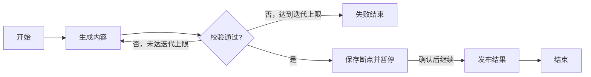

# J-Workflow

一个以 Java 实现的工作流执行引擎，目标是支持**有环工作流执行、断点保存，以及工作流暂停与继续**。

项目基于现有 Java 工作流引擎重新设计执行内核，让工作流能够表达循环处理、多轮校验、人工确认和长时间运行等业务。

> V2 已实现结构化有环执行、嵌套循环、独立节点执行记录、暂停/继续、节点前断点和可选 JDBC 断点存储。旧版入口仍保留 DAG 限制。并行汇聚尚在建设中；已验证范围见 [实施进度](docs/实施进度.md)，运行示例见 [V2 工作流使用说明](docs/V2工作流使用说明.md)。

## 为什么重新设计

现有引擎将工作流限制为有向无环图（DAG），并按节点维护一次执行状态。这种模型适合一次性任务编排，但难以直接表达以下需求：

- 生成内容后进行校验，不通过时返回生成节点，直到满足条件。
- 根据运行结果反复调用工具，动态决定下一步操作。
- 执行到指定位置后暂停，等待人工确认或外部输入。
- 保存执行进度，在服务重启或任务中断后从已提交的断点恢复。

新引擎将围绕“节点可以多次执行、运行状态可以持久化、执行过程可以暂停和恢复”建立统一的执行模型。

## 核心目标

### 有环工作流执行

支持带条件回边的有环工作流，使同一节点能够在一次工作流运行中被多次执行。

- 为每次节点执行创建独立的执行实例，分别记录输入、输出和状态。
- 区分业务循环与失败重试，分别管理循环轮次和重试次数。
- 提供循环退出条件、最大迭代次数和运行时长限制。
- 通过循环作用域隔离不同轮次的数据，避免输出覆盖和跨轮次误用。
- 明确分支与汇聚规则，避免循环和并行组合时发生错误调度。

### 断点保存

将工作流的执行进度持久化，使恢复过程能够依据已提交状态继续推进。

计划保存的内容包括：

- 工作流运行标识及其绑定的定义版本。
- 节点执行实例、执行状态和重试记录。
- 节点输入输出、变量及循环作用域。
- 待执行任务、分支汇聚状态和外部事件等待信息。

断点以节点执行结果的提交边界为基础。恢复时保留已提交的执行结果；中断时尚未提交的调用需要按恢复策略处理，外部副作用通过幂等机制防止重复生效。第一阶段不保存线程栈，也不支持从节点内部任意代码行恢复。

### 暂停与继续

支持主动暂停，以及执行到指定断点或等待外部输入时暂停。

- 暂停后停止调度新的节点执行实例。
- 对正在执行的节点，第一阶段采用协作式暂停：等待其完成并提交结果，再进入已暂停状态。
- 暂停确认前持久化执行进度，确保继续执行有据可依。
- 继续时加载运行状态，从待执行位置推进，保留已完成的结果。
- 对重复的暂停、继续请求提供幂等处理。

暂停不等同于取消，也不意味着强制中断正在进行的外部调用。

## 执行示例

下面是新引擎计划支持的流程：校验不通过时重新生成，校验通过后暂停等待确认，再继续发布。

每一轮“生成内容”都拥有独立的执行记录。等待确认期间保存运行状态，收到继续指令后进入发布节点。

## 设计方向

| 组成 | 职责 |
| --- | --- |
| 工作流定义 | 描述节点、连线、路由条件、循环和断点配置，绑定明确的版本 |
| 工作流运行实例 | 管理一次运行的生命周期、执行预算和整体进度 |
| 节点执行实例 | 表示节点的一次逻辑执行，独立记录状态与结果 |
| 调度器 | 通过事件与任务队列推进控制流，支持重复激活节点 |
| 执行作用域 | 隔离循环轮次、子流程和并行分支的数据与汇聚状态 |
| 断点存储 | 持久化运行状态、执行结果及后续调度信息 |
| 运行控制 | 处理暂停、继续、取消，以及重启后的恢复 |

节点定义与运行状态分离；节点业务调用与流程调度分离。节点结果和后续调度信息需要一致地提交，避免恢复后出现任务丢失或重复推进。

## 实施计划

- [x] 拆分工作流定义、运行实例、节点执行实例和重试记录。
- [x] 用事件与队列驱动的调度机制替换递归执行链路。
- [x] 实现循环控制、条件回边和迭代作用域。
- [x] 实现运行状态与断点的持久化。
- [x] 实现暂停、继续与指定断点暂停。
- [ ] 实现服务重启后的恢复及外部调用幂等处理。
- [ ] 完善循环与并行组合时的分支、汇聚和结束判定。
- [x] 补充有环执行、断点恢复和运行控制的测试与示例。

## 代码位置

当前改造范围集中在 `core-workflow-java/`，技术基础为 Java 21、Spring Boot 和 Maven。

- `core-workflow-java/src/main/java/com/iflytek/astron/workflow/engine/`：执行引擎、节点执行器和运行上下文。
- `core-workflow-java/src/main/java/com/iflytek/astron/workflow/controller/`：工作流执行与调试入口。
- `core-workflow-java/src/test/`：Java 测试。

本阶段聚焦 Java 工作流执行引擎，仓库中其余模块保留为现有工程基础。

## 项目来源与许可

本项目在现有 PaiFlow / AstronAgent 衍生工程基础上开展 Java 引擎改造。许可证和相关声明见 [LICENSE](LICENSE) 与 [NOTICE](NOTICE)。
