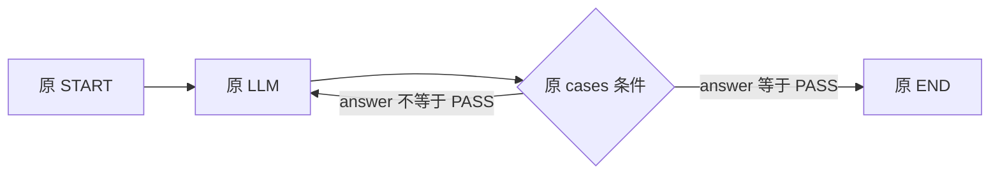

# P2 原 DSL 有环执行与分支路由验收记录

日期：2026-10-26。对应 [原引擎最小改造实施计划](原引擎最小改造实施计划.md) 的 P2。

验收状态：P2 初次验收已完成，当时新增 106 项测试，全量 271 项及打包通过。此后按原能力兼容要求补齐 P2.1 串行多后继，当前实现变化与最新验证见 [多后继兼容验收](串行多后继兼容实现与验收.md)。第 8 节保留初次验收记录。

## 1. 本阶段交付与入口范围

在 P1 的原执行器桥接基础上，增加条件分支和显式控制流队列。接受原 WorkflowDSL，沿用原 inputs、nodeParam、cases、sourceHandle 和 retryConfig；业务调用仍委托原 START、END、MOCK、LLM、插件、知识库执行器。无需新增 LOOP/BACK 定义，也无需声明结构化循环区域。

本阶段的入口是 Spring 组件 `WorkflowGraphExecutor`，供 Java 服务内部显式调用。原 HTTP 控制器尚未切换到这个入口，原串行与并行引擎继续处理既有工作流。新注册 IF_ELSE 后，旧入口会明确拒绝这类节点，防止旧调度忽略条件出口并执行多条互斥路径。

| 能力 | P2 实际状态 |
| --- | --- |
| 原格式顺序执行、互斥分支、互斥路径合并 | 内部增强入口支持 |
| 多成功后继、多失败后继及所选 case 多目标 | P2.1 已补齐，串行调度并处理共享后继 |
| 分支选择回边，同一节点执行多次 | 支持，创建独立激活记录 |
| 分支控制退出、无结构化循环容器 | 支持 |
| 每节点激活数、总激活数、总时长保护 | 支持 |
| 原错误中断、失败路由、自定义错误输出 | 复用原执行器策略 |
| 原 DAG 分叉图 | 增强入口按串行多后继处理；原线程并行入口保留 |
| 查询本次运行和节点记录 | 内部 Java 对象可查询，尚无新增管理 HTTP 接口 |
| 暂停、继续、节点前断点 | P3 待实施 |
| 持久化、服务重启后恢复 | P4/P5 待实施 |
| 线程并行及其汇聚恢复 | P6 待实施；串行多后继汇聚已提前实现 |

`start`、`tick` 和 `replay` 是内存中的内部调度能力，不代表已经实现暂停协议、持久化或消息系统中的可靠投递。

## 2. 实际执行逻辑



对应纯原格式样例：[branch-cycle.json][cycle]。运行输入另传 `{"text":"seed"}`。测试中的模型依次返回 RETRY、RETRY、PASS，轨迹为：

```text
START
LLM #1 → IF_ELSE #1 → retry 出口
LLM #2 → IF_ELSE #2 → retry 出口
LLM #3 → IF_ELSE #3 → pass 出口
END，content = Result: PASS
```

共 8 次激活；LLM 有 3 个不同 executionId，分别保存输入、输出、尝试及激活序号。IF_ELSE 的输入来源关联对应那一轮 LLM 的 executionId。

每一步执行一个逻辑激活；P2.1 可合并指向同一就绪目标的多个实际到达令牌。节点完成后按本次结果选择相应的全部边并生成后继令牌；回边的目标不受“这个节点曾经成功过”的限制。调度器不递归调用前驱，不等待未选中的静态前驱，也不对全图执行 DAG 禁环校验。

同一个令牌重复投递会被消费标识去重；真正沿回边再次到达会产生新令牌，因而创建新的 executionId。令牌包含目标、来源 executionId 和边索引，不能通过复用令牌 ID 改写目标。

这仍是有向有环图。当前约束来自原节点支持范围、有效出口和预算，不要求图满足结构化循环形状。P2.1 允许同次结果派发多个后继，并维持串行逻辑执行。结构上存在通往 END 的路径只能证明出口存在，不能证明业务条件一定会触发。

## 3. 分支条件与路由契约

### 条件配置

新增 `IfElseNodeExecutor` 补齐原 Java 实现缺失的 IF_ELSE 类型。它读取原 `nodeParam.cases`，不新增用户条件表达式语言。

- 按 cases 数组顺序判断，首个满足的条件分支生效；level 不重新排序。
- 每个条件通过 leftVarIndex/rightVarIndex 对应 InputItem.id，再读取该输入的固定值；不是把输入名称当作 ID。
- and/or 按条件数组顺序短路。未真正求值的条件不会因引用暂不存在而失败；配置中的未知输入 ID、无效引用节点仍在预检拒绝。
- 最后一个 case 必须为默认分支，conditions 为空或省略。前面的 case 必须包含有效条件。
- 每个 case ID 必须唯一，并至少对应一条 sourceHandle 相同的边；P2.1 派发所选 case 的全部连线。
- 单目操作符不解析右操作数，允许原编辑器保留未使用的右侧占位输入。
- 条件不满足是正常业务结果，IF_ELSE 仍返回 SUCCESS，并通过可选的 `NodeRunResult.selectedHandle` 选择出口，不使用失败策略表达“否”。

### 操作符

| 操作符 | 固定语义 |
| --- | --- |
| contains / not_contains | 字符串子串，或数组元素的结构值相等 |
| start_with / end_with | 区分大小写的字符串前后缀 |
| empty / not_empty | 字符串、数组或对象是否为空；null 不等于空集合 |
| null / not_null | 已存在输入的值是否为 null |
| is / is_not | Boolean 比较 |
| eq / ne | 同类型值或结构相等，数值家族按十进制数值比较 |
| gt / ge / lt / le | Number 比较 |

不将字符串 `"1"` 转为数字，也不将字符串 `"true"` 转为 Boolean。1 与 1.0 数值相等；对象键顺序不影响相等，数组顺序影响相等。顶层不兼容类型报条件类型错误，数组/对象内部不同类型则判定结构不等。

显式 null 与引用不存在分开处理。null 判断读取一个不存在的字段时报告输入不可用，不把未产生的数据当成 null 然后走默认分支。分支固定输入记录包含字段存在性和最近已提交生产者。

### 原错误路由

普通成功边继续识别空 sourceHandle 或 normal_one_of 前缀；intent_chain 前缀作为原失败边。IF_ELSE 的 case ID 与 sourceHandle 精确匹配优先，另可保留原失败边。

原 ERR_CODE_MSG 自定义输出继续走成功边；ERR_FAIL_CONDITION 走失败边；未处理错误终止运行。IF_ELSE 成功但没有合法 selectedHandle 时明确失败，不猜测出口。对于 IF_ELSE，自定义错误输出也不会自动虚构一个业务分支。

## 4. 变量、重试与执行保护

每次激活仍经过 P1 的 `NodeExecutionBridge`，保存固定输入和私有调用上下文。成功提交时整体替换该节点的最近输出；例如第一轮有 answer、第二轮没有 answer，后继不能继续读到第一轮的 answer。

重试仍由原 `AbstractNodeExecutor` 管理。一个激活内部可以产生多个 attempt，激活计数不随重试增加；下一轮回到节点才消耗新的激活次数并获得新的重试额度。

预算不放入 WorkflowDSL。服务默认值可通过 Spring 配置覆盖：

```yaml
workflow:
  control-flow:
    max-node-activations: 100
    max-total-activations: 10000
    max-duration-ms: 300000
```

调用时也可传 `WorkflowExecutionLimits` 覆盖本次运行的预算。三项均必须大于零。按节点的限制适用于每个节点；总数包括 START、IF_ELSE 和 END。检查在创建新激活前进行，不额外创建超出额度的执行记录。

总时长按 start 时刻开始的墙钟截止时间计算，包含排队、重试和等待实际调用退出。节点即使未配置 timeout，也受到运行时长保护。运行到达截止时间后不能再提交节点输出、模型历史或发布迟到的节点终态。工作流仍可发送表示失败的结束帧。

工作线程池有容量限制，派发被拒绝时取消已经准备的激活并明确失败，不留下一条永远 READY 的记录。

超时不保证外部服务调用立刻停止。不响应线程中断的调用可以继续运行，但失效结果不能覆盖变量。成功必须同时满足：有效 END 已完成、待执行令牌为空、无 READY/RUNNING 激活、实际物理调用已退出。失败可以在物理调用退出前返回；这两种终态的收敛要求不同。

队列空、没有剩余调用且未到 END 时，运行报告停滞，不能把“没有任务了”当作成功。

## 5. 执行前校验与能力边界

`WorkflowGraphCompiler` 从原 Node/Edge 建立私有定义副本和路由索引，校验：

1. flowId、节点 ID、注册执行器、节点元数据和参数；节点 ID 唯一。
2. 恰好一个 START 和 END；START 无入边、END 无出边。
3. 边的端点和 sourceHandle 有效，无重复边。
4. 原输入引用的节点和路径格式有效，启用重试时 maxRetries 非空且非负。
5. IF_ELSE 条件配置、默认分支、输入 ID 和各出口连线完整。
6. 所有节点从 START 可达，且结构上均有到 END 的路径。
7. 允许多个成功或失败后继，以及同一个 case 的多个目标，不再用后继数量拒绝合法分叉。

多个 case 之间互斥选择，所选 case 内多个目标全部派发。共享后继依据实际待执行路径收敛后合并，未选中路径不参与等待。当前只执行一个逻辑激活；具体就绪选择、回边与到达记录见 P2.1 文档，不使用原节点的全局一次性状态。

编译结果与调用方原定义分离。运行期间修改原 DSL 或读取到的 END 定义副本，不会改变已经准备好的图。

## 6. Java 调用与源码阅读

服务注入已有的 `WorkflowGraphExecutor` 后，可以显式调用：

```java
WorkflowGraphRun run = graphExecutor.execute(
        originalDsl,
        Map.of("text", "seed"),
        workflowCallback,
        new WorkflowExecutionLimits(10, 100, 30000));

WorkflowGraphRun.Status status = run.status();
Map<String, Object> outputs = run.outputs();
List<NodeActivation> executions = run.getContext().executions();
```

示例中的 originalDsl 为原 WorkflowDSL，workflowCallback 沿用原 WorkflowMsgCallback。需要导入 `WorkflowGraphRun`、`WorkflowExecutionLimits`、`NodeActivation` 以及 Java Map/List。父回调由调用服务配置，外部模型和工具仍使用原客户端与服务配置。

`execute` 负责工作流开始/结束帧以及 finished；合法运行的业务失败以 FAILED 和 errorCode/error 返回。图预检失败抛 NodeCustomException，且不会先发送工作流开始帧。

需要分步驱动时使用 `start` 后调用 `tick` 或 `runToCompletion`。这种方式的父回调生命周期由调用方负责；P2 没有后台运行注册表，也没有对外 pause/resume 接口。共享的 Spring executor 由应用生命周期管理，不应每次运行后关闭。

| 阅读顺序 | 文件与主要方法 | 关注点 |
| --- | --- | --- |
| 1 | [WorkflowGraphCompiler][compiler]：compile | 原格式校验、端口解释、迭代可达性遍历 |
| 2 | [WorkflowGraph][graph] | 独立定义副本和后继边索引 |
| 3 | [WorkflowGraphExecutor][executor]：start、tick、route | 消费令牌、调用原桥接器、选择边和检查预算 |
| 4 | [WorkflowGraphRun][graph-run]：next、replay、issueSuccessors、arrivals、finishIfIdle | 去重、多后继队列、合并来源、END 与停滞判断；新增就绪选择器见 P2.1 |
| 5 | [IfElseNodeExecutor][condition]：definition、matches、operand | 原 cases 配置、顺序短路、输入存在性 |
| 6 | [ConditionValues][values]：compare | 原操作符的类型与比较规则 |
| 7 | [WorkflowExecutionLimits][limits] | 默认预算及参数校验 |
| 8 | [P1 源码说明](P1原执行器复用与激活隔离验收记录.md) | 原节点复用、固定输入、尝试隔离、提交与迟到保护 |

本阶段只补写缺失的 IF_ELSE，不重新实现已有 LLM、插件和知识库业务执行器。

## 7. 验收用例与计划映射

| 用例组 | 重点证据 |
| --- | --- |
| [IfElseNodeExecutorTest][condition-test]（50 项） | 16 种操作符、结构比较、类型错误、显式 null、缺失引用、短路、case 顺序、默认出口、错误配置 |
| [WorkflowGraphCompilerTest][compiler-test]（当前 32 项） | 11 份原格式定义通过、不修改输入定义、非法图拒绝、多后继接受、自环接受、旧入口拒绝不支持的分支调度 |
| [WorkflowGraphExecutorTest][executor-test]（17 项） | 原 LLM 三轮回边、零轮退出、互斥合并、令牌去重、并发推进、输出替换、原错误策略、插件和知识库、千节点顺序链 |
| [WorkflowGraphBudgetTest][budget-test]（9 项） | 单节点和总激活数限制、绝对截止时间、非协作调用迟到隔离、重试计数、END 等待实际调用退出、工作池拒绝、终态缓冲与提交间到期 |
| WorkflowGraphSuccessorsTest（20 项，P2.1 新增） | 多成功／失败后继、选择 case 多目标、共享后继、嵌套交叉 DAG、循环、重放、预算、失败收敛及串行执行 |

计划中的 A04/A05/A06 由分支、循环和预算用例覆盖；A07 的跨轮缺失字段由完整循环测试覆盖。P0/P1 测试继续验证原节点、失败策略、输入输出、运行隔离和 SSE；原并行样例仍经原 ParallelWorkflowEngine 验证。

P0 固定的“注册表有 6 个原执行器且缺 IF_ELSE”是当时事实。P2 已新增第 7 个执行器，因此只将对应注册测试更新为“保留原 6 个并注册 IF_ELSE”；历史 P0 记录保留当时结论。

## 8. 验证命令与结果

全量验证使用仓库脚本：

```bash
./scripts/restart-java-workflow.sh --verify-only
```

最终运行完成时间：2026-10-26 11:26:47 +08:00。全量 **271 项，失败 0、错误 0、跳过 0**；Maven verify、JAR 构建及 Spring Boot repackage 通过，用时约 1 分 27 秒。原 165 项继续通过，P2 新增 106 项。

本机日志为 `.local/p2-final-verify.log`，产物为 `core-workflow-java/target/workflow-java.jar`，均属本地生成物，不作为源码提交。当前机器使用离线 Maven 与已有本地依赖缓存；PowerShell 复现方式：

```powershell
$p2PreviousMavenArgs = $env:MAVEN_ARGS
try {
    $env:MAVEN_ARGS = '-o -s C:/Users/Administrator/.m2/settings.xml -Dmaven.repo.local=C:/Users/Administrator/.m2/repository -DargLine=-Djava.io.tmpdir=E:/Sheepxj/Code/PaiFlow-main/.local/p0-temp'
    & 'C:/Program Files/Git/bin/bash.exe' ./scripts/restart-java-workflow.sh --verify-only
} finally {
    $env:MAVEN_ARGS = $p2PreviousMavenArgs
}
```

最后审查额外覆盖了“已缓冲节点成功事件、提交前达到截止时间”的场景：到期后不提交变量，也不发布这条未提交的成功终态。该用例先复现失败，再补充保护并通过全量验证。

Docker 守护进程当前不可连接，未进行容器构建、重启或线上模型/工具请求验收。`--verify-only` 完成的是本地 Java 验证，不等于容器部署验证。

## 9. 下一阶段交接

P3 在当前队列、令牌、执行记录和物理调用计数上增加运行管理。暂停需要阻止新派发，允许当前调用提交并保留已经选定的后继；继续消费原待执行令牌，不重新执行 START。

P4 再将定义、变量、执行记录、预算和待执行令牌持久化，并让结果提交与后继生成在同一事务内完成。当前实现没有数据库事务或跨进程去重承诺，不能直接把 Java 对象序列化当作完成重启恢复。

[cycle]: ../core-workflow-java/src/test/resources/workflows/legacy/branch-cycle.json
[compiler]: ../core-workflow-java/src/main/java/com/iflytek/astron/workflow/engine/execution/WorkflowGraphCompiler.java
[graph]: ../core-workflow-java/src/main/java/com/iflytek/astron/workflow/engine/execution/WorkflowGraph.java
[executor]: ../core-workflow-java/src/main/java/com/iflytek/astron/workflow/engine/execution/WorkflowGraphExecutor.java
[graph-run]: ../core-workflow-java/src/main/java/com/iflytek/astron/workflow/engine/execution/WorkflowGraphRun.java
[condition]: ../core-workflow-java/src/main/java/com/iflytek/astron/workflow/engine/node/impl/condition/IfElseNodeExecutor.java
[values]: ../core-workflow-java/src/main/java/com/iflytek/astron/workflow/engine/node/impl/condition/ConditionValues.java
[limits]: ../core-workflow-java/src/main/java/com/iflytek/astron/workflow/engine/execution/WorkflowExecutionLimits.java
[condition-test]: ../core-workflow-java/src/test/java/com/iflytek/astron/workflow/engine/IfElseNodeExecutorTest.java
[compiler-test]: ../core-workflow-java/src/test/java/com/iflytek/astron/workflow/engine/WorkflowGraphCompilerTest.java
[executor-test]: ../core-workflow-java/src/test/java/com/iflytek/astron/workflow/engine/WorkflowGraphExecutorTest.java
[budget-test]: ../core-workflow-java/src/test/java/com/iflytek/astron/workflow/engine/WorkflowGraphBudgetTest.java
