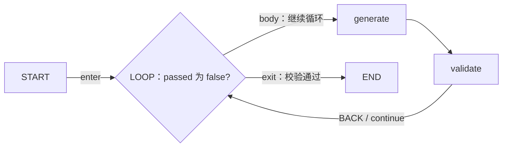
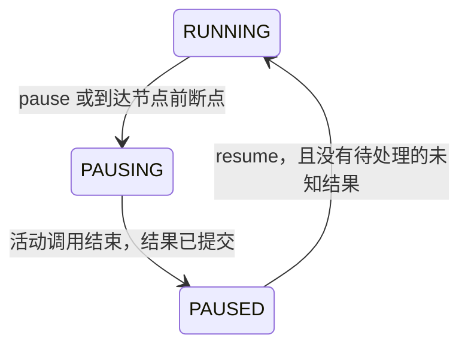

# V2 工作流引擎源码阅读指引

> 历史实验 V2 文档。当前改造与验收依据为 [原引擎最小改造实施计划](../../原引擎最小改造实施计划.md)，本文件不作为新路径的使用入口。

本文围绕两个问题组织源码阅读：**同一个节点如何在有环工作流中多次执行，以及工作流如何暂停、保存进度并在重启后继续。** 内容对应当前 Java V2 实现，文件链接可直接打开源码；方法名是主要定位依据，后续代码变更可能使行号移动。

建议先读示例，再沿调度器的关键方法阅读。第一次阅读可以跳过模型、插件、并行汇聚等集成细节。

## 1. 先找到正确的引擎入口

新引擎主要位于：

```text
core-workflow-java/src/main/java/com/iflytek/astron/workflow/
├── controller/WorkflowV2Controller.java
└── engine/v2/
    ├── definition/    工作流、循环、边和输入绑定的定义
    ├── compiler/      定义校验及执行索引构建
    ├── runtime/       运行实例、节点执行、尝试、作用域和控制令牌
    ├── scheduler/     控制流推进、循环、暂停、恢复
    ├── binding/       按作用域解析输入及记录来源
    ├── store/         内存或 JDBC 状态存储
    ├── executor/      节点的一次业务调用
    └── facade/        Spring 装配与定时推进
```

旧版 `engine/WorkflowEngine.java` 和 `engine/ParallelWorkflowEngine.java` 仍保留 DAG 执行方式。本指引中的循环和恢复实现属于 `engine/v2/`，从 [WorkflowV2Controller.java][controller] 进入。

独立服务入口是另一个包中的 [WorkflowV2Application.java][application]，类名为 `com.iflytek.astron.workflowv2.WorkflowV2Application`。启动与数据库配置见 [V2 工作流使用说明](V2工作流使用说明.md)。

### 最值得先打开的文件

| 阅读顺序 | 文件 | 先回答的问题 |
| --- | --- | --- |
| 1 | [structured-loop.json][example] | 循环在 DSL 中如何表达，条件和出口在哪里？ |
| 2 | [LoopDefinition.java][loop-definition]、[EdgeDefinition.java][edge-definition] | 循环状态、回边和迭代上限如何声明？ |
| 3 | [WorkflowRun.java][run]、[NodeExecution.java][execution]、[ExecutionScope.java][scope] | 一次运行、节点的一次执行、每轮数据分别存在哪里？ |
| 4 | [WorkflowCompiler.java][compiler] | 哪些环合法，为什么源码中还存在无环校验？ |
| 5 | [WorkflowScheduler.java][scheduler] | `tick → activate → advanceLoop / activateBusiness → dispatch → complete` 如何推进流程？ |
| 6 | [InputResolver.java][resolver] | 第二轮如何读到自己的输入，而不会混用第一轮输出？ |
| 7 | [JdbcExecutionStore.java][jdbc] | 进度如何落库，哪些内容在同一事务中提交？ |
| 8 | [WorkflowExecutionFacade.java][facade]、[JdbcCheckpointTest.java][jdbc-test] | 重启后谁发现旧任务，又如何处理结果未知的调用？ |

## 2. 先理解执行模型中的几个身份

理解下面的区别后，再读调度器会清楚很多。

| 对象 | 关键字段 | 含义 |
| --- | --- | --- |
| [NodeDefinition][node-definition] | `id`、`type`、`inputBindings` | 图中的节点定义，例如 `generate`；循环三轮仍然只有这一份定义 |
| [WorkflowRun][run] | `runId`、`executions`、`scopes`、`tokens` | 一次工作流运行，汇总当前进度和历史 |
| [NodeExecution][execution] | `executionId`、`nodeId`、`scopeId`、`inputSnapshot` | 节点的一次逻辑执行；每轮生成一个新实例 |
| [ExecutionAttempt][attempt] | `attemptId`、`attemptNo`、`deadline` | 一次逻辑执行中的调用尝试；失败重试时新增 |
| [ExecutionScope][scope] | `scopeId`、`parentScopeId`、`iterationNo`、`localState` | 循环调用、某一轮或并行分支的数据边界 |
| [ControlToken][token] | `tokenId`、`targetNodeId`、`targetPort`、`scopeId` | 待推进的控制流，说明接下来到达哪个节点及其作用域 |

例如，`generate` 执行三轮，第二轮首次调用失败后重试：

| 轮次 | nodeId | executionId（示意） | scopeId（示意） | attempts |
| --- | --- | --- | --- | --- |
| 1 | generate | execution-1 | iteration-1 | attempt-1 成功 |
| 2 | generate | execution-2 | iteration-2 | attempt-2 失败，attempt-3 成功 |
| 3 | generate | execution-3 | iteration-3 | attempt-4 成功 |

循环产生新的 `executionId` 和迭代作用域；重试保留当前 `executionId`，只产生新的 `attemptId`。源码中的实际 ID 使用 UUID。

## 3. 调用链总览：从 API 到一次节点执行

入口调用链是：

```text
WorkflowV2Controller.start()
  → WorkflowExecutionFacade.start()
    → WorkflowScheduler.start()
      → WorkflowCompiler.compile()
      → 创建 WorkflowRun、ROOT 作用域、起始 ControlToken
      → ExecutionStore.create()

WorkflowExecutionFacade.advance()：定时扫描活跃运行
  → ExecutionStore.activeRunIds()
  → WorkflowScheduler.tick(runId)
    → 在 store.update() 内推进一小步并保存状态
    → 事务提交后 dispatch()，派发准备好的节点调用
      → 工作线程执行 NodeTaskExecutor.execute()
        → complete() 提交结果并生成后续 ControlToken
```

先读 [WorkflowExecutionFacade.advance()][facade]，它使用单独的定时线程，以 10ms 固定延迟扫描活跃运行。业务调用交给工作线程池，工作线程不会占用保存运行状态的数据库事务。

再读 [WorkflowScheduler.tick()，当前第 96 行][tick]。它依次处理所有权、定义哈希和预算、超时、暂停收敛、并发容量、READY 任务、到期重试、控制令牌，以及最终完成判定。一次 `tick` 只推进有限工作，节点间通过持久化控制令牌衔接。

## 4. 第一条主线：有环工作流如何执行

### 4.1 对照一个可以执行的循环定义

打开 [structured-loop.json][example]。它是完整的启动请求，包含 `definition` 和 `inputs`，表达三轮“生成—校验”：



重点看 `loops` 中的 `refine`：

- `headerNodeId: loop`：循环控制节点。
- `bodyNodeIds: [generate, validate]`：循环体的直接成员。
- `initialState`：进入循环时从运行输入取得草稿，并将 `passed` 初始化为 false。
- `continueWhen`：循环状态中的 `passed` 为 false 时执行下一轮。
- `nextState`：一轮完成后，以本轮生成、校验结果构造下一份循环状态。
- `outputBindings`：退出时把最终草稿导出为循环输出。
- `maxIterations: 5`：允许的最大轮数；示例 MOCK 配置在第三轮校验通过。

当前实现要求声明 `LOOP`、`BACK` 回边和边界，支持结构化有环图及严格嵌套循环。直接添加任意 `A → B → A` 而不声明循环，会被拒绝。

### 4.2 为什么还有 DAG 检测

读 [WorkflowCompiler.compile()][compiler]，接着找三个方法：

| 方法 | 作用 |
| --- | --- |
| `validateBoundary()` | 校验循环入口、出口、回边的端口与归属，拒绝穿越循环边界的连线 |
| `validateLoopHierarchy()` | 校验循环嵌套关系，拒绝包含关系自身成环等错误结构 |
| `requireAcyclicWithoutBackEdges()` | 在无环校验时排除已声明的 BACK 边，检查剩余连线 |

这里的约束是：**完整工作流允许有环；排除合法 BACK 回边后，剩余图必须无环。** BACK 边仍保留在执行图中，运行时用于返回循环头。

循环头必须有 `body`、`exit` 两个出口；进入循环使用 `enter`，一轮结束返回使用 `continue`。这样的约束使调度器能够确定何时创建一轮、提交本轮状态和退出。

编译器还检查节点是否可达、是否存在到 END 的路径。存在结构上的出口并不能证明业务条件最终为假，因此运行时仍需要迭代次数和总预算限制。

### 4.3 真正控制循环的方法：advanceLoop()

这是循环执行最重要的阅读位置：[WorkflowScheduler.advanceLoop()，当前第 402 行][advance-loop]。

它有三个连续步骤：

1. **首次从 enter 进入**：创建 `LOOP` 作用域，解析 `initialState` 并保存为 `localState`。
2. **从 continue 回来**：找到本轮 `ITERATION` 及所属 `LOOP`；用本轮输出解析 `nextState`，替换循环状态，增加 `completedIterations`，关闭本轮作用域。
3. **判断下一步**：`continueWhen` 为 false 时导出结果、关闭循环，并在父作用域发出 `exit` 令牌；为 true 时检查轮数上限，创建新的 `ITERATION` 作用域，再发出 `body` 令牌。

下面是该方法中的关键片段，省略了前后的状态更新与事件记录：

```java
if (!conditions.evaluate(definition.continueWhen(), loop.getLocalState())) {
    Map<String, Object> outputs = resolver.resolve(definition.outputBindings(), run, loop.getScopeId());
    run.getScopes().get(loop.getParentScopeId()).getLoopOutputs().put(definition.loopId(), outputs);
    run.getScopes().get(loop.getParentScopeId()).getLoopOutputSources().put(definition.loopId(), loop.getScopeId());
    loop.setClosed(true);
    emitPort(run, graph, definition.headerNodeId(), "exit", loop.getParentScopeId(), null);
    event(run, "LOOP_COMPLETED", null, null, loop.getScopeId(), outputs);
} else {
    require(loop.getCompletedIterations() < definition.maxIterations(), WorkflowError.LOOP_LIMIT_EXCEEDED,
            "Loop iteration limit exceeded: " + definition.loopId());
    ExecutionScope iteration = scope(run, ScopeType.ITERATION, loop.getScopeId(), definition.loopId(),
            loop.getCompletedIterations() + 1);
    emitPort(run, graph, definition.headerNodeId(), "body", iteration.getScopeId(), null);
    event(run, "ITERATION_STARTED", null, null, iteration.getScopeId(), loop.getLocalState());
}
```

条件判断在轮数上限判断之前，因此初始条件不满足时可执行零轮，最后一轮恰好满足退出条件也可以成功；只有仍需下一轮而额度耗尽时，才以 `LOOP_LIMIT_EXCEEDED` 失败。

示例的运行作用域形成如下结构，各轮历史都会保留：

```text
ROOT
└── LOOP refine：localState、completedIterations
    ├── ITERATION 1：generate 的执行、validate 的执行，完成后 closed
    ├── ITERATION 2：generate 的执行、validate 的执行，完成后 closed
    └── ITERATION 3：generate 的执行、validate 的执行，完成后 closed
```

`LOOP` 和 `FORK` 由控制逻辑直接推进，不创建普通业务 `NodeExecution`。因此示例正常三轮成功后有 8 条节点执行记录：START 1 条，generate 3 条，validate 3 条，END 1 条。

### 4.4 同一个节点为什么能执行多次

看 [activateBusiness()，当前第 266 行][activate-business] 中的两处代码：

```java
require(!scope.isClosed() && !scope.getNodeExecutions().containsKey(node.id()),
        WorkflowError.INVALID_SCOPE, "Node activated more than once within one scope");
```

```java
execution.setExecutionId(id());
execution.setNodeId(node.id());
execution.setScopeId(scope.getScopeId());
```

同一个节点在同一个作用域内只能逻辑执行一次。每轮由 `advanceLoop()` 创建不同的迭代作用域，所以新一轮可以再次激活同一个节点定义，并创建新的执行记录。旧记录仍保存在 `WorkflowRun.executions` 中。

继续看 `prepareAttempt()`、`dispatch()` 和 `complete()`，可追踪该记录从 READY 到 RUNNING 再到成功或重试的过程。失败重试由 `failedAttempt()` 处理，重试次数属于当前节点执行，不增加循环轮数。

### 4.5 每轮的数据如何隔离

读 [InputResolver.resolve() / origins() / nodeScope() / loopScope()][resolver]：

- `NODE_OUTPUT` 通过当前指定作用域的 `nodeExecutions` 映射找到确定的 `executionId`，要求生产者执行成功。
- `CURRENT_ITERATION` 要求当前位置处于某个迭代之内；实际查询仍使用当前作用域，不会回退搜索上一轮输出。在并行分支中还要遵守分支作用域边界。
- `LOOP_STATE` 沿作用域父链找到对应循环的 `localState`，用于显式传递跨轮次数据。
- `LOOP_OUTPUT` 读取退出循环时导出到父作用域的结果。
- `activateBusiness()` 将输入保存为 `inputSnapshot`，将生产者执行 ID、作用域或循环状态版本保存为 `inputOrigins`。本次逻辑执行的重试继续使用这份输入快照。

例如，第二轮 `validate` 引用的是第二轮 `generate` 的执行记录。跨轮传递草稿通过 `nextState → LOOP_STATE` 完成。缺少本轮输出时会报 `INPUT_UNAVAILABLE`，不会取前一轮的结果补上。

## 5. 第二条主线：暂停与继续如何实现

### 5.1 主动暂停需要先收敛

从 [WorkflowV2Controller.pause() / resume()][controller] 进入，再读 [WorkflowScheduler.pause()，当前第 161 行][pause] 和 `tick()` 的 PAUSING 分支。



具体过程：

1. `pause()` 在存储事务中把 RUNNING 改为 PAUSING。
2. `tick()` 在 PAUSING 时不再派发新调用；`dispatch()` 也检查运行状态必须为 RUNNING。
3. 已经派发的调用仍可返回，通过 `complete()` 提交输出和后继令牌。
4. `tick()` 确认没有逻辑 RUNNING 执行，也没有尚未返回的物理调用后，将状态提交为 PAUSED，并释放租约。
5. `resume()` 将 PAUSED 改回 RUNNING，后续 `tick()` 处理已有 READY 任务、重试或控制令牌。

所以暂停接口返回 202 表示请求已接受；查询到 PAUSED 才表示暂停已经确认。执行中的外部调用可以在暂停收敛期间完成，后继任务会留待继续时处理。

需要同时看 `expireAttempts()` 和 `physicalAttempts`：调用逻辑超时后，即使其状态已变化，只要实际线程尚未返回，就仍占用物理容量，暂停也需要等待它收敛。当前实现没有外部调用任意位置的强制挂起能力。

### 5.2 节点前断点如何避免恢复后原地再停

看 [WorkflowScheduler.activate()，当前第 231 行][activate] 的 `node.breakpoint()` 分支：

- 到达节点时，以本次 `tokenId` 记录到 `passedBreakpoints`，设置 PAUSING，此时令牌尚未消费、节点尚未激活。
- 继续后仍处理该令牌，因为已经登记过，不会在同一次激活上再次暂停。
- 下一轮到达同一节点时会有新的令牌，所以仍可以触发断点。

`passedBreakpoints`、未消费令牌和运行状态一起存储，跨进程重启也保留该语义。

## 6. 断点具体保存了什么

先读 [ExecutionStore.java][store] 的 `create / get / update / activeRunIds`，再读 [JdbcExecutionStore.update()][jdbc] 与 [建表 SQL][sql]。

当前采用一条运行记录保存一份完整 JSON 状态，表名为 `workflow_v2_run`：

| 数据 | 对应字段 | 恢复用途 |
| --- | --- | --- |
| 定义和哈希 | `definition`、`definitionHash` | 按本次运行绑定的定义继续，重新编译并检查哈希 |
| 运行状态和所有权 | `status`、`revision`、`ownerId`、`leaseUntil` | 暂停、并发更新和调度器接管 |
| 节点执行及调用尝试 | `executions`、`attempts`、`retryAt` | 区分已完成、待派发、待重试和结果未知 |
| 输入输出及来源 | `inputSnapshot`、`inputOrigins`、`outputs` | 保留本次调用输入及已提交结果 |
| 循环状态和轮次 | `scopes` 中的 `localState`、`completedIterations`、`iterationNo` | 从原循环轮次继续 |
| 待推进位置和去重信息 | `tokens`、`consumedTokens`、`passedBreakpoints` | 保留后继控制流及断点进度 |
| 并行汇聚进度 | `parallels`、分支作用域 | 保留已到达 JOIN 的分支结果 |
| 事件和预算 | `events`、`startedAt`、`controlTransitions` | 追踪历史并继续约束执行 |

JDBC 的一次状态转移为：

```text
开启数据库事务
  → SELECT state_json ... FOR UPDATE
  → 反序列化 WorkflowRun
  → transition.accept(run)：应用本次状态变化
  → revision 加一
  → UPDATE ... WHERE run_id=? AND revision=旧值
  → 提交事务；异常时回滚
```

`complete()` 在同一个 `store.update()` 中保存成功输出、执行状态、事件和后继令牌；`advanceLoop()` 的循环状态更新与下一轮令牌也在同一更新中保存。这使已提交状态包含继续推进所需的信息。

`prepareAttempt()` 先持久化 READY 执行与尝试，再由事务外的 `dispatch()` 调用工作线程。READY 记录本身承担待派发任务的持久化职责，当前没有额外的消息中间件或独立 outbox 表。

对照 [InMemoryExecutionStore.java][memory]：它提供进程内的状态隔离与原子更新，进程退出后数据会丢失。跨进程恢复需要 JDBC 存储。原应用配置缺省为 memory，独立 V2 profile 缺省为 jdbc，装配逻辑见 [WorkflowV2Configuration.workflowV2Store()][configuration] 和 [application-workflow-v2.yml][profile]。

## 7. 进程意外退出后如何恢复

### 7.1 新进程如何找到旧运行

仍然从 [WorkflowExecutionFacade.advance()][facade] 看起。新进程启动后，它调用 JDBC 的 `activeRunIds()`，扫描数据库里 RUNNING、PAUSING 的记录，再交给 `tick()`。

PAUSED 不在自动推进列表中。已经确认暂停的工作流在重启后继续保持 PAUSED，用户对原 `runId` 调用 resume 后才重新进入扫描范围。恢复现有工作流无需再次调用 start。

编译缓存和物理线程状态没有保存到数据库；新调度器从快照中重新构建编译结果，并通过持久化执行状态判断后续处理方式。

### 7.2 最重要的恢复方法：claimOwnership()

读 [WorkflowScheduler.claimOwnership()，当前第 634 行][claim]，再回头读 `complete()` 的回调校验。

每个调度器有独立 `ownerId`，租约时长为 30 秒：

- 本调度器推进运行时续租。
- 其他调度器的租约尚有效时，本调度器不推进该运行。
- 没有所有者或原租约到期后，新调度器在状态更新事务中检查遗留 RUNNING 调用，并决定接管或暂停等待处理。

在接管时，遗留 RUNNING 尝试会标记为 `INTERRUPTED`。这表示引擎没有收到可确认提交的结果，不等于外部业务一定没有执行。

恢复策略来自节点 `config.recovery`。START、END、XOR、MOCK、JOIN 默认 RETRY；其他业务类型默认 MANUAL。只有策略为 RETRY 且尚有 `retry.maxAttempts` 额度时，才转为 RETRY_WAIT；否则节点执行转为 RECOVERY_REQUIRED，运行转为 PAUSED。

`complete()` 会检查当前所有者、租约、执行状态、当前 attemptId 及其状态。接管后旧所有者迟到的结果不能再写入该运行。这保护引擎状态，外部服务已经发生的副作用仍需由集成处理。

### 7.3 不同停机时刻对应不同恢复行为

| 停机时已提交的状态 | 恢复行为 | 重点代码 |
| --- | --- | --- |
| 节点成功，后继令牌已保存 | 保留成功结果，从后继推进 | `complete()`、`route()`、`tick()` |
| READY 任务已保存，尚未标记 RUNNING | 派发同一个尝试，不额外消耗重试次数 | `prepareAttempt()`、`tick()` 的 READY 分支、`dispatch()` |
| 已标记 RUNNING，但没有提交调用结果 | 租约到期后按结果未知处理；可能重试，也可能人工确认 | `claimOwnership()` |
| PAUSED 已保存 | 保留暂停，等待 resume | `activeRunIds()`、`resume()` |
| PAUSING 已保存 | 接管后先处理未知调用；没有未决调用时完成暂停 | `claimOwnership()`、`tick()` 的 PAUSING 分支 |

从标记 RUNNING 到实际提交结果之间，都属于可能结果未知的区间，其中也包括尚未真正调用外部服务就退出的情况。数据库状态无法单独证明一次外部调用是否产生了业务效果。

### 7.4 结果未知时如何人工处理

读 [WorkflowScheduler.resolveInterrupted()，当前第 613 行][resolve-interrupted] 和控制器的 `resolve()`。

API 为 `POST /api/workflow/v2/runs/{runId}/executions/{executionId}/resolve`，有两种动作：

| 动作 | 行为 |
| --- | --- |
| RETRY | 确认可重新调用，保留 executionId，转为 RETRY_WAIT，下一次调用新增 attempt；仍受最大尝试次数约束 |
| COMPLETE | 提供已核实的 outputs，保留 executionId，提交该逻辑执行成功并生成后继令牌，不重新调用外部服务 |

例如，外部已经执行成功，可提交：

```json
{
  "action": "COMPLETE",
  "outputs": {
    "text": "draft-1"
  }
}
```

处理完成后还需要对运行调用 resume。只要仍有 RECOVERY_REQUIRED 执行，resume 就会拒绝。手工补全时，原 attempt 保持 INTERRUPTED，用于保留故障历史。

如果关心“重试是否会导致工具重复生效”，继续读 [NodeInvocation.idempotencyKey()][invocation]、[PluginTaskExecutor.execute()][plugin] 和 [PluginIdempotencyWireTest][idempotency-test]：同一逻辑执行的重试使用稳定幂等键，不同轮次使用不同键。外部工具服务需要支持该键的去重语义，才能避免重复业务效果。

## 8. 两个能力组合起来是什么样

假设第二轮 `generate` 已成功提交，此时暂停并重启进程：

```text
停机前保存：
  refine 循环已完成第 1 轮
  第 2 轮 ITERATION 仍打开
  第 2 轮 generate 已成功，输入输出及 executionId 已保存
  待执行 validate 的令牌已保存
  运行状态 PAUSED

重启并 resume 后：
  读取相同 runId 的状态
  消费已有 validate 令牌
  validate 读取第 2 轮 generate 的结果
  回到 LOOP，提交第 2 轮 nextState
  条件仍需循环时创建第 3 轮 ITERATION
```

对应源码组合为 `activateBusiness() + InputResolver + complete()/route() + JdbcExecutionStore.update() + resume()/tick()`。如果停机时第二轮 `generate` 仍为 RUNNING，则还要先经过上一节的未知结果恢复流程。

## 9. 推荐对照阅读的测试

### 循环执行

| 测试文件 | 测试方法 | 验证内容 |
| --- | --- | --- |
| [WorkflowSchedulerTest][scheduler-test] | `executesThreeIterationsWithIndependentHistoryAndExportsFinalOutput` | 三轮独立执行历史、输入来源与最终输出 |
| 同上 | `retriesWithinEachIterationWithoutConsumingAnotherIteration` | 重试与轮次分别计数 |
| 同上 | `doesNotReadAPreviousIterationsMissingOutput` | 缺少本轮输出时拒绝跨轮误读 |
| 同上 | `supportsZeroIterationsWithAnExplicitInitialOutput` | 零轮执行及初始输出 |
| 同上 | `permitsSuccessOnTheLastAllowedIterationButFailsIfAnotherIsRequired` | 最后一轮成功与超限的区别 |
| [NestedLoopTest][nested-test] | `reentersTheInnerLoopWithIndependentStateForEachOuterIteration` | 外层每一轮重新进入内层时拥有独立状态 |
| [WorkflowCompilerTest][compiler-test] | 阅读合法循环与非法回边、循环边界相关用例 | 编译阶段如何确定允许的图结构 |

### 暂停与中断恢复

| 测试文件 | 测试方法 | 验证内容 |
| --- | --- | --- |
| [WorkflowSchedulerTest][scheduler-test] | `pauseLetsTheCurrentCallCommitWithoutStartingItsSuccessor` | 暂停允许当前调用提交，后继暂不执行 |
| 同上 | `breakpointPausesOncePerActivationAndCanBeContinued` | 同次激活的断点只暂停一次 |
| [JdbcCheckpointTest][jdbc-test] | `resumesAPersistedPausedLoopWithANewStoreAndScheduler` | 替换存储对象和调度器后继续原循环，保留已提交执行 |
| 同上 | `checkpointSurvivesClosingAndReopeningTheDatabase` | 关闭并重开文件数据库后继续 |
| 同上 | `aQueuedAttemptIsDurableAndCanBeDispatchedWithoutConsumingARetry` | 构造已提交 READY 状态，恢复派发且不额外消耗尝试 |
| 同上 | `recoversAnUncommittedDispatchAfterLeaseExpiryWithoutAcceptingTheOldOwnersResult` | 租约到期接管、保留中断记录、拒绝旧所有者结果 |
| 同上 | `unknownResultCanBeResolvedManuallyWithoutRepeatingTheExternalCall` | 未知结果需要先处理，人工补全可避免再次调用 |
| 同上 | `transactionRollsBackBothProgressAndProducedTokens` | 状态转移失败时，进度与令牌一起回滚 |
| [ParallelWorkflowTest][parallel-test] | `persistedPartialJoinSurvivesAStoreAndSchedulerReplacement` | 部分分支已到达 JOIN 时恢复汇聚进度 |

上述 JDBC 测试使用 H2；它们覆盖存储和调度器行为。真实 Java 进程退出、重启及 MySQL 场景看 [verify-workflow-v2-restart.ps1][restart-script]，已有验证记录见 [阶段验收记录](阶段验收记录.md)。脚本会创建测试运行并停止自己启动的 Java 进程，应使用独立测试数据库。

想在 IDE 逐步跟踪时，可优先调试 `WorkflowSchedulerTest` 和 `JdbcCheckpointTest`。它们使用可控执行器和时钟，比直接调试后台定时线程更容易观察每次状态变化。

## 10. 建议设置的源码断点

| 想观察什么 | 断点位置 | 建议查看的变量 |
| --- | --- | --- |
| 第一轮从哪里开始 | `advanceLoop()` 的 enter 分支 | `token.targetPort()`、`loop.localState` |
| 每轮怎样独立 | `advanceLoop()` 创建 ITERATION 后、`activateBusiness()` | `scopeId`、`iterationNo`、`executionId` |
| 本轮读了哪次输出 | `InputResolver.resolve()` 的 NODE_OUTPUT 分支 | `scope.nodeExecutions`、生产者 `executionId` |
| 何时退出循环 | `advanceLoop()` 的条件分支 | `completedIterations`、`localState`、`continueWhen` |
| 暂停何时真正完成 | `pause()`、`tick()` 的 PAUSING 分支 | `status`、`physicalCount`、活动执行状态 |
| 断点后为何可以继续 | `activate()` 的 breakpoint 分支 | `tokenId`、`passedBreakpoints` |
| 一次结果提交了什么 | `complete()`、`JdbcExecutionStore.update()` | `executions`、`tokens`、`revision` |
| 进程故障后如何决策 | `claimOwnership()` | `ownerId`、`leaseUntil`、attempt 状态、recovery 策略 |
| 人工补全如何接回控制流 | `resolveInterrupted()` → `route()` | 原 `executionId`、补全输出、后继令牌 |

这些是 IDE 调试断点，与 DSL 中触发运行暂停的 `breakpoint: true` 属于不同用途。

## 11. 阅读时需要保留的实现边界

- 当前支持声明边界的结构化循环与严格嵌套循环，任意跳转形成的非结构化环仍会被拒绝。
- 恢复依据已经提交的运行状态，执行位置粒度是节点调用及调度状态转移，不保存 Java 线程栈，也不能从节点内部某一行继续。
- 主动暂停等待活动调用收敛；取消通过协作信号处理，二者都不能撤销已经发生的外部业务效果。
- 已成功提交的节点执行会保留；RUNNING 中断调用的实际结果可能未知，重试或人工处理由恢复策略决定。
- 当前总时长按 `startedAt` 起算的墙钟时长判断，暂停和停机时间也计入 `maxDurationMs`。
- 当前 JDBC 实现按整份运行 JSON 保存历史，适合理解一致性边界；历史持续增长时，快照大小、写入量和事件归档是后续扩展点。

## 12. 只读最核心代码时的路线

如果先集中理解这两个能力，可以按下面的顺序读完一遍，再进入其他文件：

1. [循环示例][example] → [LoopDefinition][loop-definition]：理解图、状态和出口。
2. [WorkflowRun][run] → [NodeExecution][execution] → [ExecutionScope][scope]：理解多次执行如何存储。
3. [WorkflowCompiler][compiler] 的循环边界校验和 `requireAcyclicWithoutBackEdges()`：理解允许哪些环。
4. [WorkflowScheduler][scheduler] 的 `tick → activate → advanceLoop → activateBusiness → complete`：理解循环如何一步步执行。
5. [InputResolver][resolver]：理解轮次隔离和输入快照。
6. [WorkflowScheduler][scheduler] 的 `pause / resume` 与 [JdbcExecutionStore.update()][jdbc]：理解暂停和进度提交。
7. [WorkflowExecutionFacade.advance()][facade] → [WorkflowScheduler.claimOwnership()][claim] → `resolveInterrupted()`：理解重启接管与结果未知的处理。
8. [WorkflowSchedulerTest][scheduler-test] 和 [JdbcCheckpointTest][jdbc-test]：用可执行场景验证上述理解。

[example]: ../../../core-workflow-java/examples/structured-loop.json
[controller]: ../../../core-workflow-java/src/main/java/com/iflytek/astron/workflow/controller/WorkflowV2Controller.java
[application]: ../../../core-workflow-java/src/main/java/com/iflytek/astron/workflowv2/WorkflowV2Application.java
[loop-definition]: ../../../core-workflow-java/src/main/java/com/iflytek/astron/workflow/engine/v2/definition/LoopDefinition.java
[edge-definition]: ../../../core-workflow-java/src/main/java/com/iflytek/astron/workflow/engine/v2/definition/EdgeDefinition.java
[node-definition]: ../../../core-workflow-java/src/main/java/com/iflytek/astron/workflow/engine/v2/definition/NodeDefinition.java
[run]: ../../../core-workflow-java/src/main/java/com/iflytek/astron/workflow/engine/v2/runtime/WorkflowRun.java
[execution]: ../../../core-workflow-java/src/main/java/com/iflytek/astron/workflow/engine/v2/runtime/NodeExecution.java
[attempt]: ../../../core-workflow-java/src/main/java/com/iflytek/astron/workflow/engine/v2/runtime/ExecutionAttempt.java
[scope]: ../../../core-workflow-java/src/main/java/com/iflytek/astron/workflow/engine/v2/runtime/ExecutionScope.java
[token]: ../../../core-workflow-java/src/main/java/com/iflytek/astron/workflow/engine/v2/runtime/ControlToken.java
[compiler]: ../../../core-workflow-java/src/main/java/com/iflytek/astron/workflow/engine/v2/compiler/WorkflowCompiler.java
[scheduler]: ../../../core-workflow-java/src/main/java/com/iflytek/astron/workflow/engine/v2/scheduler/WorkflowScheduler.java
[tick]: ../../../core-workflow-java/src/main/java/com/iflytek/astron/workflow/engine/v2/scheduler/WorkflowScheduler.java#L96
[advance-loop]: ../../../core-workflow-java/src/main/java/com/iflytek/astron/workflow/engine/v2/scheduler/WorkflowScheduler.java#L402
[activate-business]: ../../../core-workflow-java/src/main/java/com/iflytek/astron/workflow/engine/v2/scheduler/WorkflowScheduler.java#L266
[pause]: ../../../core-workflow-java/src/main/java/com/iflytek/astron/workflow/engine/v2/scheduler/WorkflowScheduler.java#L161
[activate]: ../../../core-workflow-java/src/main/java/com/iflytek/astron/workflow/engine/v2/scheduler/WorkflowScheduler.java#L231
[claim]: ../../../core-workflow-java/src/main/java/com/iflytek/astron/workflow/engine/v2/scheduler/WorkflowScheduler.java#L634
[resolve-interrupted]: ../../../core-workflow-java/src/main/java/com/iflytek/astron/workflow/engine/v2/scheduler/WorkflowScheduler.java#L613
[resolver]: ../../../core-workflow-java/src/main/java/com/iflytek/astron/workflow/engine/v2/binding/InputResolver.java
[store]: ../../../core-workflow-java/src/main/java/com/iflytek/astron/workflow/engine/v2/store/ExecutionStore.java
[jdbc]: ../../../core-workflow-java/src/main/java/com/iflytek/astron/workflow/engine/v2/store/JdbcExecutionStore.java
[memory]: ../../../core-workflow-java/src/main/java/com/iflytek/astron/workflow/engine/v2/store/InMemoryExecutionStore.java
[sql]: ../../../core-workflow-java/src/main/resources/db/workflow-v2.sql
[facade]: ../../../core-workflow-java/src/main/java/com/iflytek/astron/workflow/engine/v2/facade/WorkflowExecutionFacade.java
[configuration]: ../../../core-workflow-java/src/main/java/com/iflytek/astron/workflow/engine/v2/facade/WorkflowV2Configuration.java
[profile]: ../../../core-workflow-java/src/main/resources/application-workflow-v2.yml
[invocation]: ../../../core-workflow-java/src/main/java/com/iflytek/astron/workflow/engine/v2/executor/NodeInvocation.java
[plugin]: ../../../core-workflow-java/src/main/java/com/iflytek/astron/workflow/engine/v2/executor/PluginTaskExecutor.java
[scheduler-test]: ../../../core-workflow-java/src/test/java/com/iflytek/astron/workflow/engine/v2/WorkflowSchedulerTest.java
[jdbc-test]: ../../../core-workflow-java/src/test/java/com/iflytek/astron/workflow/engine/v2/JdbcCheckpointTest.java
[nested-test]: ../../../core-workflow-java/src/test/java/com/iflytek/astron/workflow/engine/v2/NestedLoopTest.java
[compiler-test]: ../../../core-workflow-java/src/test/java/com/iflytek/astron/workflow/engine/v2/WorkflowCompilerTest.java
[parallel-test]: ../../../core-workflow-java/src/test/java/com/iflytek/astron/workflow/engine/v2/ParallelWorkflowTest.java
[idempotency-test]: ../../../core-workflow-java/src/test/java/com/iflytek/astron/workflow/engine/v2/PluginIdempotencyWireTest.java
[restart-script]: ../../../scripts/verify-workflow-v2-restart.ps1
