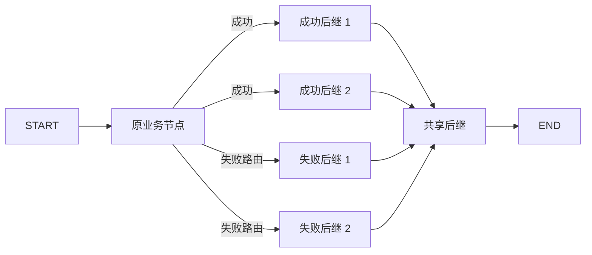

# 串行多后继兼容实现与验收

日期：2026-10-26。对应原引擎最小改造计划的 P2.1，提前补齐原能力兼容；不引入同一运行内的线程并行。

## 1. 范围与同步基线

实现之前已检查工作区为空，执行 git fetch origin，再以 fast-forward 合并 origin/feature/structured-loop-engine；本地从 39ab98e 更新到 **a9ef5cf**。远程新增的执行层源码注释保留，修改以该提交为基线。

本次目标是保留原引擎通过 nextNodes / failNodes 表达的多后继能力：

| 本次节点结果 | 派发行为 |
| --- | --- |
| SUCCESS | 派发全部正常后继 |
| ERR_CODE_MSG | 保留自定义错误输出，派发全部正常后继 |
| ERR_FAIL_CONDITION | 派发全部失败后继 |
| IF_ELSE 成功 | 按原 cases 选一个 case，派发这个 case 的全部目标 |
| 未处理的执行错误 | 运行失败，停止剩余派发 |

沿用原 WorkflowDSL、inputs、retryConfig 和 sourceHandle，无新增用户协议或 FORK/JOIN/LOOP 节点。普通边保持空 handle / normal_one_of 的解释，失败边保持 intent_chain 的解释。

当前入口仍是内部 Java 组件 WorkflowGraphExecutor。原 HTTP 入口和原线程并行引擎没有切换，暂停与持久化恢复仍属于后续阶段。

## 2. 运行示例与结果

新增原格式样例：[multiple-outcomes.json][example]。运行输入仍另传 {"text":"seed"}。



该样例默认让 work 失败并使用错误分支策略：两个失败后继都执行，两个正常后继不执行，merge 只执行一次，输出 content=Result: joined。

测试还将同一份样例调整为业务成功或自定义错误输出，验证两个正常后继都执行、失败后继不执行。重试过程中不派发后继，最后接受的激活结果才派发一次。

多个后继进入待执行队列后按就绪依赖串行推进。它们不会同时占用本运行的逻辑执行位；独立就绪节点保留队列和原连线顺序作为选择依据，不承诺复现旧递归调用栈的所有访问顺序。

## 3. 为什么还增加了就绪选择

仅把 route 的 getFirst 改为 for 循环，会让同一个共享后继收到多次到达；普通 FIFO 也可能在长分支尚未结束时提前执行汇聚节点。

本次增加内部 WorkflowTokenScheduler，接入 WorkflowGraphRun.next：

1. 对待执行令牌按目标节点分组；同一令牌的重复投递先去重。
2. 判断其他已派发路径是否仍能在本次遍历中到达该目标。仍可能汇入时暂缓目标，先执行其上游工作。
3. 从就绪目标中稳定选一个，把当前同目标的到达合并为一次激活。
4. 保留每个后继的遍历历史；目标已经出现在该历史中时识别为回边，截断该段历史后形成新的推进。
5. 就绪依赖本身成环时，在没有外部前置依赖的强连通组中选择入口推进，避免等待尚未发生的未来回边。
6. END 等待其他目标全部处理，再合并其到达并执行一次。某条实际路径没有合法后继时立即报告停滞，不能由其他路径到达 END 掩盖。

这里不等待所有静态前驱。IF_ELSE 和失败策略没有选中的路径不会产生令牌；决策节点处理完后，那些路径不再阻止汇聚。

遍历历史用于本次串行推进的依赖判断，不是对任意图中每个业务循环轮数的全局定义，也不是新增的线程并行批次。真正线程并行时仍需重新处理分支变量隔离、部分完成恢复等 P6 事项。

## 4. 合并与循环怎样共存

```text
LLM 第 1 次 → left、right → merge 第 1 次 → IF_ELSE → 回跳
LLM 第 2 次 → left、right → merge 第 2 次 → IF_ELSE → 回跳
LLM 第 3 次 → left、right → merge 第 3 次 → IF_ELSE → END
```

同一轮左右两路的实际到达合并一次；下一轮再到达会创建新的 executionId。没有使用“这个 nodeId 已经执行过”这样的全局跳过规则。

测试验证了：

- 左右分支每轮都执行，merge 每轮都执行一次。
- merge 的输入值和 inputOrigins.executionId 对应那一轮左右执行器的已提交结果。
- 两个分支同时回到同一个循环节点时，新一轮只激活一次。
- 一路内部反复循环、另一路已到汇聚点时，汇聚等待循环一路真正到达。
- 同一节点的失败处理后继也能汇聚、判断并回跳。
- 无限回跳仍在原激活预算处失败；合并的多份到达只消耗一次节点激活额度。

## 5. 重点源码

| 文件 | 本次修改 | 阅读重点 |
| --- | --- | --- |
| [WorkflowGraphCompiler][compiler] | 去掉成功/失败后继最多一个的限制；case 仍须至少有一条有效连线 | 端口、重复边、输入引用、START/END 和可达性校验继续保留 |
| [WorkflowGraphExecutor][executor] | route 派发全部所选边；显式处理没有后继的实际路径 | IF_ELSE 只选择 case；多个后继的数量不再被当作路由错误 |
| [WorkflowGraphRun][run] | next 合并就绪到达；issueSuccessors 逐边建令牌；arrivals 提供来源查询 | 同一 tick 只激活一个节点；合并到达的令牌均标记消费 |
| [WorkflowTokenScheduler][scheduler] | 新增就绪依赖、反馈路径与合并选择 | select、choose、blocks、canReach、registerSuccessor |

WorkflowTokenScheduler 是包内辅助类，不新增线程，也没有自己的同步锁；可变状态由调用它的 WorkflowGraphRun 实例锁保护。节点执行仍通过原 NodeExecutionBridge，LLM、插件、知识库和原重试业务方法没有改写。

合并时使用代表令牌的 ID 作为 activationId，全部实际来源可以查询：

```java
NodeActivation merge = run.getContext().executions().stream()
        .filter(item -> item.nodeId().equals("mock::merge"))
        .findFirst()
        .orElseThrow();

List<WorkflowGraphRun.Token> sources = run.arrivals(merge.activationId());
```

sources 中保留每条来源的 sourceExecutionId 与 edgeIndex。重放任一已消费到达都不会再次执行该次合并；新的回边到达仍会创建新的激活。

## 6. 验收用例

[WorkflowGraphSuccessorsTest][tests] 当前 20 项，包含参数化用例。

| 用例组 | 主要检查 |
| --- | --- |
| 原分叉样例对照 | parallel-fork.json 在增强路径与原串行引擎输出一致，merge 执行一次 |
| 三种结果 | 成功、失败路由、自定义错误输出分别派发全部正确后继，不运行对立路径 |
| 长短分支 | 长分支完成前不解析共享后继输入，最终输入同时包含两路结果 |
| 嵌套交叉 DAG | 中间共享节点不会因多条路径到达而重复执行 |
| 可复现的多种 DAG | 固定随机种子生成 20 个不同分叉汇聚图，每个节点恰好执行一次 |
| IF_ELSE 多目标 | 选中 case 的多条连线全部执行，未选中 case 不执行 |
| 循环分叉 | 三轮成功后继分叉与三轮失败后继分叉都正确汇聚 |
| 循环嵌套与回边 | 内部循环等待、两路反馈合并、多入口有环图不等待未来前驱 |
| 去重 | 重放单个汇聚到达仍只执行一次，并保留两份不同来源 |
| 串行约束 | 第一路调用阻塞时，第二路尚未开始；另一次 tick 不能抢占推进 |
| 预算 | 汇聚消耗一个激活额度，无限回跳不能绕过上限 |
| 失败收敛 | 已有 END 到达时其他路径停滞仍失败；未处理错误中断剩余工作 |
| 原重试语义 | 最后一次尝试后才派发失败后继，每个后继只执行一次 |

[WorkflowGraphCompilerTest][compiler-tests] 增加 parallel-fork 和 multiple-outcomes 的接受用例，并将原三种“拒绝多后继”的断言改为接受。非法端口的执行前拒绝测试继续保留。

## 7. 验证方法与结果

单独运行新增兼容测试：

```powershell
mvn -B -f core-workflow-java/pom.xml '-Dtest=WorkflowGraphSuccessorsTest' test
```

按仓库要求运行全部 Java 测试及打包：

```bash
./scripts/restart-java-workflow.sh --verify-only
```

本机复用 P2 相同的离线 Maven 设置与缓存，完整验证日志为 .local/multi-successors-final-verify.log。最终结束时间 **2026-10-26 21:07:53 +08:00**，全量 **293 项，失败 0、错误 0、跳过 0**，Maven verify 与 Spring Boot 打包通过，用时约 1 分 27 秒。

测试构成为既有 89 项、P0 基线 48 项、P1 隔离 28 项，以及当前 P2/兼容扩展 128 项。相比 P2 初次验收的 271 项，本次新增 20 项专门用例与 2 组编译样例；原有三种拒绝分叉的断言调整为接受，非法端口仍在派发前拒绝。

未执行容器重启及真实外部服务请求。原 Python 基线、历史 V2 和原业务执行器不在本次修改范围。

## 8. 后续阶段交接

多后继作为兼容要求已经提前进入串行路径，不能再用“线程并行未做”解释它的缺失。

P3 在当前就绪队列与激活记录上增加暂停/继续。P4 快照除原定义、变量和令牌外，还须保存遍历历史、反馈标记以及合并到达信息，才能在恢复后保持相同的就绪与去重语义。P6 再增加同一运行内的线程并行及其隔离，当前不宣称这部分已经完成。

[example]: ../core-workflow-java/src/test/resources/workflows/legacy/multiple-outcomes.json
[compiler]: ../core-workflow-java/src/main/java/com/iflytek/astron/workflow/engine/execution/WorkflowGraphCompiler.java
[executor]: ../core-workflow-java/src/main/java/com/iflytek/astron/workflow/engine/execution/WorkflowGraphExecutor.java
[run]: ../core-workflow-java/src/main/java/com/iflytek/astron/workflow/engine/execution/WorkflowGraphRun.java
[scheduler]: ../core-workflow-java/src/main/java/com/iflytek/astron/workflow/engine/execution/WorkflowTokenScheduler.java
[tests]: ../core-workflow-java/src/test/java/com/iflytek/astron/workflow/engine/WorkflowGraphSuccessorsTest.java
[compiler-tests]: ../core-workflow-java/src/test/java/com/iflytek/astron/workflow/engine/WorkflowGraphCompilerTest.java
