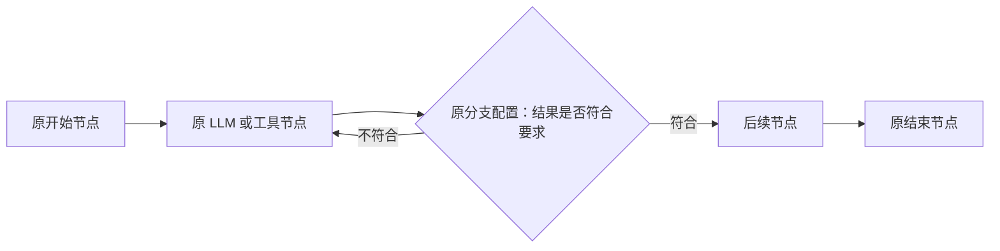

# 原引擎最小改造实施计划：有环执行、暂停与恢复

制定日期：2026-10-25。

状态：P0、P1、P2 已完成验收，下一阶段为 P3。以下复选项均表示本计划的交付状态，不继承已有 V2 实现的完成状态。实际证据见 [P0 兼容性基线](P0兼容性基线与验收记录.md)、[P1 原执行器复用与激活隔离验收记录](P1原执行器复用与激活隔离验收记录.md) 和 [P2 原 DSL 有环执行与分支路由验收记录](P2原DSL有环执行与分支路由验收记录.md)。

适用范围：仅 Java 工作流引擎 `core-workflow-java/`。Python 基线保持原样。

本文是后续实施依据。此前的 [节点多次执行机制设计与实施计划](history/v2/节点多次执行机制设计与实施计划.md)、[实施进度](history/v2/实施进度.md)、[V2 源码阅读指引](history/v2/V2工作流引擎源码阅读指引.md) 描述已有结构化 V2 方案，继续保留为历史与技术参考；涉及后续方向时以本文为准。

## 1. 需求与改造原则

目标是在原引擎已有能力上支持有环工作流，以及节点边界的暂停、进度保存和恢复。

必须保留的基础：

1. 原 `WorkflowDSL`、`Node.data.inputs`、`nodeParam`、`outputs`、`retryConfig` 和原有输入引用方式。
2. 原连线 `sourceNodeId`、`targetNodeId`、`sourceHandle`。
3. `engine/node/` 下的 `NodeExecutor` 与已有业务执行器，包括开始、结束、LLM、插件和知识库节点。
4. 已有节点参数解释、输出格式、失败策略及 DAG 工作流行为。
5. 原有执行入口与调试入口的兼容性；运行控制可以增加接口或可选请求参数。

具体原则：

- 分支节点决定下一条边，边可以返回前面的节点，从而再次执行。
- 不要求用户把已有图重写为 V2 DSL，不强制添加 LOOP、BACK、循环区域或新的输入绑定协议。
- 节点定义与本次执行状态在内部区分，内部模型不要求成为新的用户协议。
- 每次执行继续委托原 `NodeExecutor`，不另写一套 LLM、插件、知识库业务逻辑。
- 必要改动优先放在调度、公共执行基类、运行上下文、变量提交和存储层。
- 先完成串行调度下的分支循环、多成功后继、多失败后继和恢复，线程并行另阶段实现。
- 新路径使用明确的能力校验；不支持的结构在执行前报错，不静默改变汇聚语义或回退执行。

“最小改造”以复用业务能力、兼容已有定义和控制改动范围为准。原引擎的一次性状态和静态前驱等待假设仍需修改，不能仅移除无环检查。

## 2. 业务语义与首批支持范围

### 2.1 分支控制循环



业务条件负责退出。执行次数、总步数和时长限制负责阻止无限运行；达到保护上限时失败并给出原因，不伪装成业务条件满足。

当前支持顺序执行、互斥分支、路径合并，以及这些结构形成的回跳。普通节点成功或失败后，派发对应的全部后继；IF_ELSE 每次只选择一个 case，该 case 的全部目标都需要执行。互斥条件选择与多后继派发是两个层次，不能把一对多派发误解释成只取其中一条边。

多成功后继和多失败后继作为原能力兼容要求提前交付，不再等待 P6。增强路径每次只执行一个逻辑激活，在派发多条令牌后，依据待执行路径的可达性决定就绪顺序；同一目标的实际到达合并执行，不等待未选中路径。原有线程并行引擎继续保留，P6 再处理线程并行及其持久化与汇聚隔离。

### 2.2 重复执行与重试

| 概念 | 定义 | 示例 |
| --- | --- | --- |
| 节点定义 | 图中一个固定节点 | `spark-llm::001` |
| 节点激活 | 控制流每次到达该节点形成一次逻辑执行 | 第二次返回该节点，创建新的执行记录 |
| 调用尝试 | 一次激活内由原重试配置产生的调用 | 本次激活第一次失败，第二次成功 |
| 执行保护计数 | 按运行累计或按节点累计的激活次数 | 限制本次运行最多激活该节点 10 次 |

新增激活计数不复用 `Node.executedCount`；后者现用于原重试流程。新一轮激活拥有独立重试额度，但故障后对同一次激活重试，不能借重建节点无限重置额度。

首批不承诺自动识别任意复杂图中每个环的精确轮次。默认使用总激活数、每节点激活数及总时长作为保护；若以后需要“指定循环最多 N 轮”，再增加可选的计数目标，不强制全图迁移。

### 2.3 变量语义

串行增强路径继续使用原 `nodeId + 输出名` 引用：引用最近一次已提交的该节点输出。

- 每次成功提交整体替换该节点的输出映射，避免上一轮独有字段残留。
- 每次激活保存固定输入和输入来源，重试使用同一份业务输入。
- 执行历史单独按 executionId 保留，变量池不承担保存全部历史的职责。
- 不对所有未执行分支统一清空变量；默认最近一次已提交输出在回跳后仍然可引用。
- 首次访问尚未产生的节点输出，不自动猜测初值；缺失与显式 null 分别处理。
- 对已有 DAG 的缺失值、null、对象和列表引用行为先做契约核实；如增强路径需要严格报错，必须明确记录差异并保持旧路径行为。

循环携带数据需要明确第一轮初值。首批示例优先采用开始节点输入与显式默认值；若现有 DSL 无法表达“首次取输入、后续取上轮输出”，先设计局部、可选的默认值或运行变量扩展，并为旧请求保留原解释，不能隐式读取未来输出。

### 2.4 暂停与恢复的粒度

- 暂停发生在节点调用与状态提交边界，不保存 Java 线程栈。
- 主动暂停先停止新派发，再等待当前调用收敛，最终提交 PAUSED。
- 继续同一个 runId，保留已提交结果和待执行位置，不重新 start。
- 已暂停运行重启后保持暂停；不因为服务启动而自动继续。
- 进程退出时仍在执行的调用视为结果未知，按明确策略处理。
- 浏览器 SSE 断开不等于工作流取消，运行控制与连接生命周期分开。
- 恢复不会撤销已发生的外部副作用。

人工等待首批通过暂停和继续表达。不同时引入外部事件总线、任意变量编辑或节点内部挂起协议。

## 3. 已核实的源码现状

本节为实施前的现状，不表示下述缺口已经修复。路径相对于 `core-workflow-java/src/main/java/com/iflytek/astron/workflow/`。

| 文件或位置 | 当前行为 | 必要调整 |
| --- | --- | --- |
| `engine/WorkflowEngine.java` | 拒绝环；已完成节点直接返回；递归处理静态前驱和后继 | 引入可重复激活的推进逻辑，保留原执行器注册 |
| `engine/ParallelWorkflowEngine.java` | 按节点对象状态等待全部前驱 | 保留 DAG 路径，循环并行另行定义激活与汇聚批次 |
| `engine/domain/chain/Node.java` | 定义、状态、重试计数、对象邻接关系混合 | 每次激活构建独立执行视图，不序列化对象引用图 |
| `engine/node/AbstractNodeExecutor.java` | 包含重试、输入解析、变量写入和回调 | 增加固定输入、局部输出及执行身份支持，避免与调度器重复管理重试 |
| `engine/VariablePool.java` | 按字段写入，保存节点最近输出 | 增加快照、恢复、整体替换及私有执行视图 |
| `engine/constants/NodeTypeEnum.java` | 已有 IF_ELSE、DECISION_MAKING 等类型 | 枚举存在不代表执行器已实现 |
| `engine/node/impl/` | 已有开始、结束、LLM、插件、知识库等；当前未找到 IF_ELSE 执行器 | 补齐原分支配置的 Java 执行能力 |
| `engine/WorkflowEngine.java` 构建连线 | 主要区分 normal_one_of 与 intent_chain | 补齐业务分支出口匹配，不能把条件未通过等同节点异常 |
| `engine/node/callback/WorkflowMsgCallback.java` | 开始、结束回调会修改传入 NodeRunResult 的输入输出 | 回调使用展示副本，持久化结果保持完整 |
| `engine/integration/model/LlmChatHistory.java` | 历史存在进程缓存 | 开启历史时，需要保存或重建恢复所需历史 |
| `controller/WorkflowController.java` | `/api/workflow/chat` 将工作流执行与 SSE 请求关联 | 保留旧请求，新增可独立管理的运行服务 |
| `engine/v2/` | 新 DSL、新执行接口、结构化循环及持久化恢复 | 按能力复用，不作为外部定义迁移的前提 |

前端 `console/frontend/src/components/workflow/nodes/if-else/index.tsx` 已含 `nodeParam.cases`、`logicalOperator`、`compareOperator` 和 `branch_one_of` 出口。它是兼容性核对资料，本计划不修改前端或 Python 来配合新的循环协议。

## 4. 内部实现的建议边界

下列对象是职责建议，不要求逐一创建同名类，也不要求照搬 V2 的包结构。

| 职责 | 最少包含的内容 |
| --- | --- |
| 图索引 | 原节点索引、按 sourceHandle 分组的出边、入边与能力校验结果 |
| 运行状态 | runId、原定义快照及哈希、运行状态、版本、预算、变量、待执行激活 |
| 节点激活记录 | executionId、nodeId、该节点激活序号、触发来源、固定输入、输出、状态、尝试信息 |
| 待执行记录 | 稳定 activationId、目标节点、触发边或出口、来源 executionId |
| 执行桥接 | 构建原 NodeState，委托已注册 NodeExecutor，关联本次输入、输出和回调 |
| 存储接口 | 创建、读取、事务更新、查找可推进运行 |
| 运行控制 | start、get、pause、resume、cancel、处理中断调用 |

建议推进方式：

```text
原 WorkflowDSL
  → 校验与图索引
  → 创建运行及开始节点激活
  → 从待执行队列领取一个激活
  → 构造独立 Node 执行视图与私有变量视图
  → 调用原 NodeExecutor.execute(NodeState)
  → 得到完整业务结果
  → 根据成功/失败策略及分支出口确定后继
  → 一次提交结果、变量、计数和后继记录
  → 继续推进，或在节点边界暂停
```

执行视图保留原 nodeId 及业务配置；不要把 nodeId 改成 executionId，避免破坏原输入引用、节点类型识别和模型历史键。executionId 通过内部上下文携带。原定义在创建运行时复制，执行时不修改公共定义对象。

首批可只允许一个活动激活，但推进队列仍是显式数据结构。调度不能依赖递归调用栈、工作线程剩余数或共享 Node.status 判断整次运行是否完成。

## 5. 阶段与依赖

| 阶段 | 目标 | 依赖 | 主要交付 |
| --- | --- | --- | --- |
| P0 | 核实兼容契约并准备样例 | 无 | 差异清单、原 DSL 样例、基线测试 |
| P1 | 原执行器复用及内部激活模型 | P0 | 固定输入、私有执行视图、完整结果提交 |
| P2 | 原分支节点及有环执行 | P1 | 原 DSL 分支回跳、保护预算、独立执行记录 |
| P3 | 暂停、继续、断点与事件 | P2 | 内存运行控制及兼容回调 |
| P4 | 持久化与已确认暂停后的重启恢复 | P3 | JDBC 快照、事务一致性、暂停重启验证 |
| P5 | 运行中故障恢复与副作用处理 | P4 | 未知结果处理、接管校验、真实进程故障验证 |
| P6 | 循环与并行组合 | P5 | 分支批次与汇聚恢复，按受支持结构推进 |
| P7 | 入口整合、文档及旧 V2 收敛 | 核心依赖 P5；并行内容依赖 P6 | 默认路径切换依据、回归及迁移说明 |

核心目标的验收门槛是 P0～P5，并包含提前补齐的串行多后继兼容。P6 的线程并行不阻塞串行循环与恢复交付；P7 的核心入口与文档工作可以在 P5 后完成，线程并行部分在 P6 后补齐。

## 6. P0：兼容性核实与实施基线

### 工作内容

- [x] 清点原 NodeExecutor 注册列表与节点参数，不以类型枚举代替实际支持清单。
- [x] 整理原 DAG、错误分支、自定义错误输出、LLM 历史、结束节点输出及 SSE 顺序样例。
- [x] 使用原格式 JSON 构造分支回跳样例，不使用 V2 DSL 作为唯一验收输入。
- [x] 核对分支 cases 的顺序、默认分支、比较操作符、类型转换及缺失值语义。
- [x] 锁定 `maxRetries`、timeout、retryInterval 与错误策略的实际行为。
- [x] 核实开始、结束节点回调改写结果的行为，记录业务结果与 SSE 展示结果的差别。
- [x] 核实 VariablePool 对缺失字段、null、列表、对象和嵌套路径的现有行为。
- [x] 明确 P0 时点首批支持图：单控制路径、互斥分支及合并；后续已通过 P2.1 提前补齐串行多后继与汇聚兼容。
- [x] 记录旧路径、增强路径、实验 V2 路径的入口和选择方式；同一次运行绑定固定路径。

### 代码范围与产物

重点阅读原 `WorkflowEngine`、`ParallelWorkflowEngine`、`NodeExecutor`、`AbstractNodeExecutor`、`WorkflowMsgCallback`、`WorkflowDSL`、`NodeRunResult` 和 `WorkflowService` 的 DSL 加载过程。

复用 `LegacyExecutionContractTest`、`LegacyWorkflowCompatibilityTest`、`VariablePoolTest`、`WorkflowMsgCallbackTest` 等已有测试。新增原 DSL 样例和简明兼容矩阵，记录当前确实通过的验证命令和结果。

### 验收与进入下一阶段的条件

1. 每项旧行为均有样例或测试依据，不能把推测写成兼容保证。
2. 分支字段可从原前端定义一直对应到 Java DTO，无须改名或重写 DSL。
3. 明确原 `maxRetries = 2` 等边界行为及其新路径处理方式。
4. 确定旧入口的完成、异常和连接关闭契约。
5. 基线失败与环境限制单独记录，不能由新特性测试掩盖。

完成标志：后续阶段可以对照一组固定旧样例判断兼容性，而不是只检查新模型自身。

2026-10-25 已完成：10 份原 DSL 样例、48 项新增契约测试，包含原有测试的全量 137 项通过并完成打包。分支求值仍未实现；基线明确区分当前缺口与 P2 契约。旧 V2 文档已归档，有实际引用的源码与测试保留。详见 [P0 验收记录](P0兼容性基线与验收记录.md)。

## 7. P1：原执行器复用与激活隔离

### 工作内容

- [x] 在运行层引入独立激活身份与记录，不更改原业务 nodeId。
- [x] 为一次激活构建私有 Node 执行视图，原状态和重试计数不跨激活复用。
- [x] 继续通过已有 `Map<NodeTypeEnum, NodeExecutor>` 或同等注册机制调用原执行器。
- [x] 为本次激活固定输入；原基类的重试继续使用该输入，而非重读不断变化的全局变量。
- [x] 变量写入先进入本次执行视图，最终由运行层发布已确认结果。
- [x] 为 VariablePool 增加 JSON 可保存的快照、恢复和单节点输出整体替换能力。
- [x] 区分业务结果与展示回调副本，避免 START/END 回调改写用于状态提交的结果。
- [x] 统一运行上下文安装和清理，保持 flowId、chatId、nodeId 的原业务含义。
- [x] 对超时及迟到调用增加有效性检查；过期输出与回调不能发布到当前运行。
- [x] 复用原重试和错误处理策略，不再叠加一层默认自动重试。

### 实现约束

允许调整 `AbstractNodeExecutor` 的公共流程或增加可选内部上下文，以实现固定输入、调用身份、输出隔离和回调副本。已有 NodeState 构造方式与执行入口应保留兼容适配，不能要求所有节点重写业务方法。

每次超时调用尝试应拥有可识别的身份或隔离视图。仅按 executionId 丢弃旧激活结果还不够：同一次激活中第一次超时、第二次成功后，第一次迟到返回也不能覆盖第二次结果。新增校验不要求原 LLM、插件、知识库复制业务实现。

对于开始、结束节点，先在公共层保留完整业务输入输出，再向旧展示逻辑提供副本。不能只对执行器返回的结果直接取 outputs，因为它可能已经被原回调修改。

### 验收

1. 开始、结束、LLM、插件和知识库的调用能够证明经过原 NodeExecutor 实例。
2. 通过替身服务验证原 LLM 参数、输出配置、历史开关，原插件调用与知识库输出保持兼容；默认测试不调用付费外部服务。
3. 同一节点连续激活三次，各次重试计数独立；旧 maxRetries 语义保持一致。
4. 两次独立运行互不污染变量、上下文和回调。
5. 第一次调用超时后迟到，不能改写随后已提交输出或发送误归属的终态事件。
6. 原开始、结束节点的业务结果完整保存，SSE 展示仍满足旧契约。

完成标志：内部运行层可以复用现有节点能力，而不依赖 V2 的业务节点包装。

2026-10-25 已完成：NodeExecutionBridge 直接注入并调用原 NodeExecutor；新增独立激活、固定输入及来源、私有变量和历史、展示副本与迟到保护。原业务执行器文件及 DSL 未改写。新增 28 项测试，全量 165 项及打包通过。包括流式背压下取消与消费者读取运行状态的验证。详见 [P1 验收记录](P1原执行器复用与激活隔离验收记录.md)。

## 8. P2：条件分支与原 DSL 的有环执行

### 工作内容

- [x] 新增缺失的 IF_ELSE 执行器，沿用原 cases、条件输入引用和 sourceHandle。
- [x] 将选中的分支出口作为路由元数据返回，可对 NodeRunResult 增加可选字段；不把业务不匹配伪装成错误状态。
- [x] 使用原 Edge 构建路由索引，保留 normal_one_of、intent_chain 等已有错误分支解释。
- [x] 实现显式待执行队列；互斥合并由实际到达的激活触发。
- [x] 在增强路径中移除全图 DAG 禁止，替换已执行即跳过和递归等待全部静态前驱的规则。
- [x] 同一个节点再次到达时创建新 executionId，重复投递同一个 activationId 则只处理一次。
- [x] 加入每节点激活上限、总激活上限和总运行时长保护。
- [x] 执行前检查节点和端口有效、开始结束约束、可达性及支持结构。
- [x] 结束条件包括已到达有效 END 且没有未决工作；队列空但未到 END 时明确报告停滞。
- [x] 原 DAG 线程并行保留原路径；增强路径以明确的串行策略保留多后继及汇聚语义。

### 分支与预算口径

分支按原配置顺序求值，首个匹配的业务分支生效，默认分支作为最后兜底。P0 若发现既有约定不同，应在兼容矩阵中明确后再实施，不照搬 V2 的“多个匹配即报错”作为新默认规则。

操作符按实际原配置形成支持清单。未知操作符、无默认且无匹配、出口没有对应连线、同一互斥出口连接多个目标等情况明确报错或交由后续支持的分叉语义处理。

预算优先来自服务配置和可选运行参数，不强制修改 WorkflowDSL。计数在创建逻辑激活时增加，失败重试不占用新的业务激活次数。精确的每环轮次暂不作为通用计数承诺。

图上存在通往 END 的边不代表业务条件一定退出；预算检查仍必须存在。

### 验收

1. 原格式“生成 → IF_ELSE → 返回生成/结束”运行三次后退出，保存三份生成记录。
2. 起始条件已满足时，分支可以直接走出口。
3. 两个业务条件同时满足时按已确定顺序选择，默认分支行为正确。
4. 不选择的分支不执行，不必等待其状态完成。
5. 回边不会导致首次进入等待未来前驱，也不会递归溢出。
6. 持续选择回跳时，在保护上限停止并报告明确原因。
7. 本轮输出整体替换旧输出，固定输入与最近已提交输出的读取符合约定。
8. 原错误中断、失败分支和自定义错误输出的样例继续通过。
9. 非法节点、引用、端口及缺失出口在执行前被识别；合法多后继不因数量大于一而被拒绝。

完成标志 M1：使用原 DSL 和原节点执行器完成受支持的有环流程，业务循环无需 LOOP 定义。

2026-10-26 已完成：WorkflowGraphExecutor 显式接入原执行器桥接层，补齐原 IF_ELSE，支持控制令牌驱动的分支、回边和互斥合并，加入激活数与截止时间保护。P2 新增 106 项测试，全量 271 项及打包通过。当前入口为内部 Java 组件，原 HTTP 未切换；暂停、继续、持久化和并行循环仍按后续阶段实施。详见 [P2 验收记录与源码指引](P2原DSL有环执行与分支路由验收记录.md)。

### P2.1：提前补齐串行多后继兼容

根据原能力兼容要求，本项在 P3 前实施，详情见 [多后继兼容实现与验收](串行多后继兼容实现与验收.md)。

- [x] 实现前先 fetch 并 fast-forward 同步到远程最新提交 a9ef5cf。
- [x] 成功后派发全部成功后继，失败路由派发全部失败后继，保留原错误策略与重试语义。
- [x] IF_ELSE 选中 case 后派发该出口的全部目标，不派发其他 case。
- [x] 单次运行仍串行执行逻辑激活；共享目标等实际可到达的路径收敛后合并一次。
- [x] 循环再次到达创建新激活；同次实际到达及令牌重放去重，不按 nodeId 全局跳过。
- [x] END 等待其他待执行节点，某条路径停滞或失败不能被另一条路径到达 END 掩盖。

P4 的快照还须保存本次扩展引入的遍历历史、反馈标记与合并到达记录，不能只保存待执行目标 ID。

2026-10-26 21:07:53 +08:00 完成全量验收：293 项，失败、错误和跳过均为 0，Java 打包通过。本次增加 20 项多后继专门测试与 2 组编译样例；原三种分叉拒绝用例改为接受，非法端口仍执行前拒绝。

## 9. P3：暂停、继续、节点前断点与事件

### 工作内容

- [ ] 引入 RUNNING、PAUSING、PAUSED、SUCCEEDED、FAILED、CANCELLED 运行状态。
- [ ] pause 请求设置 PAUSING，领取和派发入口同时停止新调用。
- [ ] 当前调用允许提交结果和后继；活动逻辑调用与实际物理调用收敛后进入 PAUSED。
- [ ] resume 使用已有待执行记录推进，不清空变量，不重新执行 START。
- [ ] 节点前断点以一次激活为单位记录是否已通过，继续后不会在原位置再次暂停。
- [ ] 断点位置先通过可选运行参数指定 nodeId 集合，不强制改动原节点配置。
- [ ] 增加可独立于 SSE 查询的运行与执行记录。
- [ ] 明确取消、暂停、连接断开的差别；连接资源可释放，运行状态不依赖连接存活。
- [ ] 内部事件关联 runId、executionId、activationId、nodeId 和顺序号；旧 SSE 字段保持兼容。

### 运行控制接口建议

在原 `/api/workflow/chat` 之外增加运行管理入口，建议使用以下路径，最终实施前核对现有路由：

| 接口 | 用途 |
| --- | --- |
| `POST /api/workflow/runs` | 使用原 DSL 或 flowId 创建运行，返回 runId |
| `GET /api/workflow/runs/{runId}` | 查询状态、进度与输出 |
| `POST /api/workflow/runs/{runId}/pause` | 请求暂停 |
| `POST /api/workflow/runs/{runId}/resume` | 继续已确认暂停的运行 |
| `POST /api/workflow/runs/{runId}/cancel` | 取消运行 |
| `GET /api/workflow/runs/{runId}/events` | 增量查询运行事件 |

新增管理接口是运行能力扩展，不代表要求使用新 DSL。创建请求中的预算、断点等配置与原图定义分开。

### 验收

1. 暂停请求返回仅表示接受，查询 PAUSED 才表示暂停确认。
2. 当前节点完成后保留结果，但后继未开始；继续后后继执行一次。
3. 每轮到达同一断点都会暂停，同一激活继续后不重复暂停。
4. 重复 pause/resume 的有效状态幂等；PAUSING 不能当成已暂停来恢复。
5. 取消后迟到回调不能改变运行终态。
6. SSE 断开或消费者退出后，运行结果仍可查询；资源回收符合旧接口与新接口各自契约。

本阶段使用内存存储时只宣称进程内暂停与继续，不宣称重启恢复。

## 10. P4：持久化快照与已暂停运行的重启恢复

### 工作内容

- [ ] 建立存储接口，先适配内存，再实现 JDBC；评估复用 V2 事务存储的可行边界。
- [ ] 保存原定义 JSON、内容哈希和快照格式版本；格式版本用于内部恢复，不要求新增外部 dslVersion。
- [ ] 快照保存运行状态、变量、固定输入、节点执行、尝试信息、待执行记录、预算和断点标记。
- [ ] 保存模型历史开关启用时所需的历史数据或可重建记录，并在继续前恢复；失败尝试是否计入历史沿用经核实的契约。
- [ ] 在同一事务中提交输出、变量替换、执行状态、分支选择与后继记录。
- [ ] 待调用记录先持久化，事务提交后执行；不在数据库事务中调用模型或工具。
- [ ] 使用行锁或版本控制保护转移，并确保异常回滚不发布内存中的半成品。
- [ ] 保存 PAUSED 状态，重建运行对象后保持暂停；用户 resume 原 runId 才推进。
- [ ] 将存储配置、数据库脚本与 Java 工作流数据源明确绑定。

### 快照内容

| 类别 | 必需内容 |
| --- | --- |
| 定义 | 原 WorkflowDSL 的纯定义快照、哈希、绑定的实现标识及快照版本 |
| 运行 | runId、状态、revision、开始时间、累计预算、错误信息 |
| 控制位置 | 待执行激活、已经消费或提交的激活标识、断点通过记录 |
| 执行 | executionId、nodeId、触发来源、输入输出、状态及重试计数 |
| 变量与上下文 | 最近已提交输出、必要模型历史、原 flowId/chatId 等业务标识 |
| 事件 | 关键状态转移和可查询顺序号；流式片段的保存范围单独规定 |

不保存线程池、回调对象、SseEmitter、ThreadLocal、Future、数据库连接和 Node 邻接对象引用。恢复时从原定义重新构建索引和执行视图。

预算默认按开始后的墙钟时长计算，暂停和停机时间计入。需要长时间人工等待时应配置相应上限；若后续改为只计算活动时间，作为显式策略增加测试。

### 验收

1. 第二次节点激活完成后暂停，关闭服务，重启并继续，已经提交的执行 ID 与结果不变。
2. 保留下一步分支选择，不因重启重新求值并走另一条边。
3. READY 任务恢复后派发同一激活，不额外产生业务激活或重试记录。
4. 故意在结果提交前抛异常，输出、变量、计数、后继记录一起回滚。
5. 原定义存储被修改不影响已运行实例；快照不兼容或无法解码时明确拒绝恢复。
6. 开启 LLM 历史的模拟场景，重启前后构建的下一次模型请求保持一致。
7. H2 可用于快速事务测试；另用真实 MySQL 和新 Java 进程验证持久化，不以替换内存对象代替全部重启验证。

完成标志 M2：原 DSL 工作流可确认暂停、跨进程保存，并从原运行继续。

## 11. P5：执行中故障、未知结果与接管

### 工作内容

- [ ] 区分未派发 READY 与已经标记 RUNNING 的执行；RUNNING 到结果提交之间视为可能结果未知。
- [ ] 新进程扫描可恢复运行，按所有权与版本规则接管，避免两个调度器同时提交。
- [ ] 复用或适配租约和执行代次检查；旧所有者、旧尝试的迟到结果无效。
- [ ] 未知调用保留 INTERRUPTED 历史；需要人工处理时标记 RECOVERY_REQUIRED 并暂停运行。
- [ ] 对外部副作用节点默认采用人工确认；允许明确配置可安全自动重试的节点。
- [ ] 提供 RETRY 与 COMPLETE 两种处理动作；处理后显式 resume，不隐式重启整图。
- [ ] 记录剩余重试额度，恢复同一次激活不得清零计数后无限重放。
- [ ] 幂等键按 runId、executionId 和业务作用生成，同一激活重试稳定，不同激活分别生成。
- [ ] 由原插件执行器及原调用上下文传递幂等键，不再另写插件业务实现。
- [ ] 状态查询可看到未知执行、已确认结果与恢复动作；不能把未知结果直接记为确定失败。

### 恢复决策

| 持久化状态 | 处理 |
| --- | --- |
| 结果已提交，后继已保存 | 保留结果并处理后继，不重做原节点 |
| READY，尚未转 RUNNING | 继续派发已有任务 |
| RUNNING，无结果提交 | 接管确认后按未知结果策略处理 |
| PAUSED | 保持暂停，等待 resume |
| PAUSING | 处理未决调用后完成暂停，或停在待人工处理状态 |
| 已终态 | 不自动复活 |

COMPLETE 使用人工核实的输出提交原 executionId，保留原中断尝试历史，不发起外部调用。RETRY 仍属于原激活，受剩余尝试或明确的人工重试额度约束。

租约只能保护引擎状态提交，不能取消旧实例已经发出的外部请求；工具服务是否支持幂等去重需要单独验证。

### 验收

1. 外部测试工具记录“业务已经生效”，但返回前杀死 Java；重启后不盲目自动重复该操作。
2. 人工 COMPLETE 后从后继继续，原 executionId 保留，外部调用没有重复。
3. 允许重试的测试工具接收到稳定幂等键，调用重放而业务只生效一次。
4. 同一业务节点的新激活使用新键，能够产生新一轮合法业务效果。
5. 旧所有者迟到回调及旧尝试流片段不能覆盖接管后的状态。
6. 存在 RECOVERY_REQUIRED 时 resume 被拒绝；额度耗尽时明确提示处理方式。
7. 真实进程验证脚本记录数据库状态、进程重启、执行 ID 与工具效果次数，测试资源可清理。

完成标志 M3：核心需求完整验收，既支持确认暂停后的恢复，也明确处理运行中进程故障。

## 12. P6：循环与并行组合的增强

串行多成功后继、多失败后继及汇聚已经在 P2.1 提前实现；本阶段不再把这项原能力兼容作为尚未开始的线程并行功能。

本阶段不反向要求用户迁移为 V2 的 parallels、FORK/JOIN 声明。先用真实原 DSL 样例明确分叉和汇聚语义，内部识别不足时再考虑局部、可选的元数据，不能通过猜测运行任意交叉图。

### 工作内容

- [ ] 对原 DAG 并行路径建立对照样例，明确现有汇聚与错误分支行为。
- [ ] 为实际并行分叉创建内部批次和分支身份，同一轮只接受该批次的汇聚结果。
- [ ] 区分互斥合并与 AND 汇聚，不能统一等待所有静态入边。
- [ ] 持久化已到达分支、剩余分支、分支变量视图及后继激活。
- [ ] 明确并行变量读取与合并规则；同一 nodeId 可能并发执行时不再只依赖全局最近输出。
- [ ] 支持暂停等待所有已派发调用收敛，恢复后保留部分汇聚进度。
- [ ] 首先交付无重叠、可识别的分叉汇聚；复杂交叉与跨批次回跳继续明确拒绝。

### 验收

1. 原 DAG 并行样例的输出、错误处理和执行次数保持兼容。
2. 循环每次进入分叉形成新批次，上一轮结果不能满足本轮汇聚。
3. 部分分支完成后暂停重启，不重做已提交分支，不提前启动汇聚后继。
4. 一个分支失败、重试或待人工恢复时，其他分支结果保留且最终状态一致。
5. 未支持的交叉结构在启动前给出原因。

完成标志 M4：在明确支持范围内，循环与并行组合具备隔离、暂停及恢复语义。

## 13. P7：入口整合、旧 V2 取舍与交付

### 工作内容

- [ ] 将增强运行服务接入原工作流加载与原 NodeExecutor 注册流程。
- [ ] 保留 `/api/workflow/chat` 请求结构、原节点调试入口和已验证 SSE 契约。
- [ ] 明确增强运行的异步控制入口、事件订阅方式，以及旧同步接口如何等待结果。
- [ ] 使用显式配置或可选运行参数灰度选择；同一次运行持久化所选实现，恢复时不临时更换。
- [ ] 在回归通过后确定默认路径，不以检测失败后自动降级代替明确选择。
- [ ] 更新 README、使用说明、源码指引和验收记录，区分已交付、暂不支持及历史实验。
- [ ] 清点实验 V2 的依赖、样例和数据库记录，再决定保留、弃用或删除的顺序。
- [ ] 为历史快照保留明确读取路径或迁移说明，不直接让旧 V2 记录使用新状态类解码。

### 已有 V2 的取舍

| 内容 | 处理原则 |
| --- | --- |
| 事务存储、版本检查、所有权和迟到结果校验 | 优先复用思路与测试，适配新的内部状态，不机械复制整套模型 |
| 独立执行身份、固定输入、事件关联 | 保留必要机制，服务原执行器与原 DSL |
| 暂停收敛、READY 派发、人工补全、进程验证 | 保留行为要求并改用原 DSL 验收 |
| LlmTaskExecutor、PluginTaskExecutor 等业务包装 | 不作为新路径主实现，逐步由原执行器桥接替代 |
| 强制 LOOP/BACK、loops、parallels 与新输入绑定 | 不作为用户接入前提；历史 V2 按其原入口管理 |
| MOCK、循环、恢复和幂等测试 | 复用用例思想，补充原执行器端到端证据 |
| 原 V2 表与历史运行 | 不在本计划编写阶段删除；收敛时单独制定兼容和处置步骤 |

不以删除代码作为本阶段完成标准。只有新路径已经验收、引用清点完成、历史数据已有处理办法，才进入删除或弃用操作。

### 最终交付验收

1. 用户提交原格式工作流，无须转换为 V2 DSL，即可表达分支回跳。
2. 原业务执行器实际参与执行，原节点参数和输出能力可追踪验证。
3. 原运行可以暂停、保存、重启并继续；未知外部结果有明确处理入口。
4. 单路径与并行支持范围清楚，未支持结构明确报错。
5. 新旧路径的选择、默认值、配置及回滚方式写入使用说明。
6. 只有本计划实际通过的项目才能标记完成，历史 V2 测试不能代替新路径验收。

## 14. 统一验收场景

| 编号 | 场景 | 阶段 | 预期 |
| --- | --- | --- | --- |
| A01 | 原开始 → LLM → 结束 | P0/P1/P7 | 参数、输出、历史与事件兼容 |
| A02 | 原插件、知识库执行 | P1/P7 | 调用原执行器，结果格式兼容 |
| A03 | 三次业务激活，每次可独立重试 | P1/P2 | 激活数与尝试数分开 |
| A04 | 原 IF_ELSE 条件、顺序、默认出口 | P2 | 正确选择 sourceHandle |
| A05 | 分支回跳三次后退出 | P2 | 无 LOOP 定义，无静态前驱死等 |
| A06 | 始终回跳 | P2 | 预算终止，不宣称业务成功 |
| A07 | 上轮输出有 x，本轮没有 x | P1/P2 | 本轮输出无残留 x |
| A08 | 两个运行使用相同节点 ID | P1/P2 | 变量和状态相互隔离 |
| A09 | 调用中主动暂停后继续 | P3 | 当前结果保存，后继延后且只执行一次 |
| A10 | 同节点每次激活触发前置断点 | P3 | 每次可停，同次继续不原地再停 |
| A11 | 超时后迟到、旧尝试晚于新尝试返回 | P1/P3/P5 | 无迟到覆盖、无误归属终态 |
| A12 | 第二次激活后暂停并重启 | P4 | 原 runId 与已提交记录保持不变 |
| A13 | 提交结果中途异常 | P4 | 结果、变量及后继一致回滚 |
| A14 | 有模型历史时暂停重启 | P4 | 下一次请求恢复必要上下文 |
| A15 | 外部已生效、引擎未提交就退出 | P5 | 未知结果，不盲目重复 |
| A16 | 人工补全及幂等重试 | P5 | 原激活继续，业务效果符合策略 |
| A17 | 原 DAG 并行及错误分支 | P0/P7 | 原路径行为保持兼容 |
| A18 | 循环内并行、部分汇聚重启 | P6 | 批次隔离，已完成分支不重做 |
| A19 | SSE 断开、重复控制请求 | P3/P7 | 生命周期清楚，运行可查，资源可释放 |

## 15. 每个阶段的执行与记录方式

后续每次实施按以下顺序推进，不一次性开展全部阶段：

1. 确认阶段前置条件，查看工作区与现有变更，保留其他工作。
2. 列出本阶段拟修改文件和验收用例；若需要改变本文已约定的外部语义，先更新计划与差异说明。
3. 完成实现及有意义的契约测试，不为低影响文档变更补写实现镜像测试。
4. 运行相应 Java 检查；Java 代码变更按仓库要求执行 `scripts/restart-java-workflow.sh`。
5. Docker 不可用时可用 `--verify-only` 验证构建，并记录未完成的容器检查；真实进程、数据库验证单独记录，不能声称已完成容器部署。
6. 记录实际通过的命令、样例、结果和限制，更新本计划复选项及独立验收记录。
7. 完成当前阶段验收后再推进下一阶段。提交与远程同步按用户后续指示执行，不把提交成功当成能力验收。

已知测试基线和其他线程改动必须区分记录。全量检查如因已有问题失败，说明与本阶段的关系，并完成受影响范围的验证。

### 阶段记录模板

```text
阶段：
日期与代码版本：
完成事项：
修改文件与原因：
复用的原节点能力：
外部协议是否变化：
验证命令与结果：
原 DSL 验收样例及运行结果：
未验证项或已知限制：
下一阶段进入条件：
```

## 16. 当前执行清单

- [x] P0：原行为、分支协议与兼容性基线。
- [x] P1：原执行器桥接、固定输入、独立激活与输出隔离。
- [x] P2：原分支节点、控制流队列和有环执行，补齐 P2.1 串行多成功／失败后继兼容。
- [ ] P3：暂停、继续、节点前断点及兼容事件。
- [ ] P4：事务快照与已确认暂停后的重启恢复。
- [ ] P5：运行中故障、未知结果处理与幂等验证。
- [ ] P6：循环与并行组合增强。
- [ ] P7：入口整合、回归验收、文档和旧 V2 收敛。

下一阶段从 P3 开始。P2 已在显式内部入口完成原 DSL 有环图调度；暂停、继续、重启恢复及 HTTP 入口整合仍需按计划独立实现与验收。
