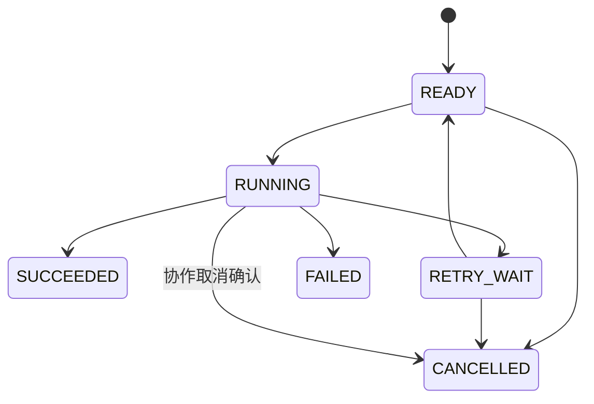
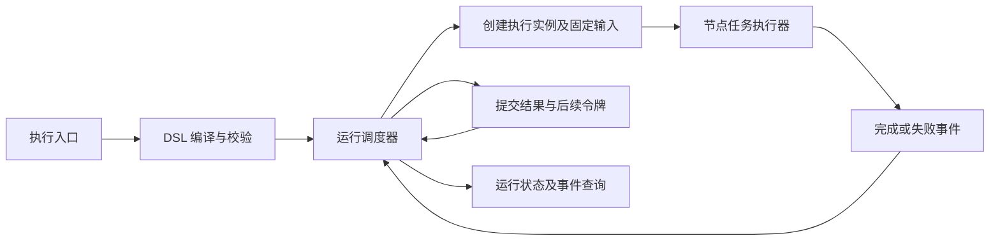
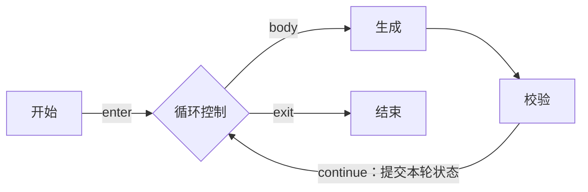

# 节点多次执行机制设计与实施计划

状态：已按阶段实施；实际交付与验证证据见 [实施进度](实施进度.md) 和 [阶段验收记录](阶段验收记录.md)。本文保留原始设计及阶段安排，现状分析指改造前的 Java 引擎。

适用项目：J-Workflow。

改造范围：`core-workflow-java/`，仅考虑 Java 工作流执行引擎。

## 1. 目标与范围

本方案使同一个节点定义能够在一次工作流运行中被多次激活和执行，并确保每次执行的数据、状态、重试和事件相互独立。

核心业务是：生成内容后进行校验，校验未通过时返回生成节点，反复执行直到通过或达到限制。类似机制可以用于结果修正、分页处理和多轮工具调用。

本方案分为基础版本和增强版本：

| 范围 | 基础版本 | 增强版本 |
| --- | --- | --- |
| 节点多次执行 | 独立执行实例、输入输出和重试记录 | 并行多实例 |
| 有环图 | 显式循环区域、循环控制节点和回边 | 嵌套循环及更多循环形式 |
| 分支 | 单路由条件分支、排他合并 | 配对的并行分叉与汇聚 |
| 状态存储 | 内存实现和统一存储接口 | 数据库事务、持久化任务和恢复 |
| 运行控制 | 总步数、轮数、时长限制和协作取消 | 断点保存、暂停与继续 |

基础版本不承诺任意有向图都可执行，不支持无声明的跨循环跳转、任意交叉并行汇聚、节点内部任意代码行恢复。对于不支持的结构，发布或执行前明确报错。

内存版本完成后，只能证明多次执行语义正确，不能宣传为已具备服务重启恢复能力。

## 2. 当前实现与问题

以下路径均相对于仓库根目录。

| 代码位置 | 当前实现 | 改造原因 |
| --- | --- | --- |
| `engine/WorkflowEngine.java` | `verifyWorkflow()` 使用 Kahn 算法拒绝环；`executeNode()` 对已完成节点直接返回 | 环不能进入执行，节点也无法再次激活 |
| `engine/WorkflowEngine.java` | 递归执行未完成前驱，再执行后继 | 回边会破坏静态前驱等待条件，也可能造成递归调用环 |
| `engine/ParallelWorkflowEngine.java` | 对已完成或运行中节点去重，等待全部静态前驱 | 无法区分不同轮次；循环首次进入时可能等待尚未发生的回边 |
| `engine/ParallelWorkflowEngine.java` | 活动任务数为零时完成运行 | 任务数不能表达未满足的汇聚、等待事件和恢复任务 |
| `engine/domain/chain/Node.java` | 节点配置与 `status`、`executedCount`、前后驱对象引用放在一起 | 一个节点对象无法表达多次执行的不同状态 |
| `engine/node/AbstractNodeExecutor.java` | 增加节点上的执行计数；内部重试、写变量、发送回调 | 业务执行、重试、结果提交和运行事件耦合 |
| `engine/VariablePool.java` | 按节点 ID 和输出名保存一份数据 | 后一轮输出覆盖前一轮，无法表达作用域和确定的输入来源 |
| `engine/domain/chain/Edge.java` | 主要包含源、目标和源端口 | 缺少稳定边 ID、路由条件、回边及循环归属 |
| `controller/WorkflowController.java` 等入口 | 注入 `WorkflowEngine`，每次创建 `VariablePool` | 新引擎需要通过统一入口逐步接入 |

上述 `engine/` 和 `controller/` 位于 `core-workflow-java/src/main/java/com/iflytek/astron/workflow/`。

补充说明：

- 现有入口已经为每次请求创建变量池；问题主要在单次运行内部的轮次隔离，不能仅凭变量池中的旧注释认定它当前跨请求共享。
- `Node.executedCount` 当前参与失败重试计数，不代表业务循环次数。
- `NodeTypeEnum` 中存在迭代类型，但当前实现中没有找到对应的 Java 节点执行器。
- 删除 `hasCycle()`、重置节点状态或清空变量池，都不足以形成正确的多次执行机制。

## 3. 关键设计决策

1. 节点定义不保存运行状态，一次激活对应一个独立执行实例。
2. 业务循环创建新执行实例；失败重试创建同一执行实例的新尝试。
3. 通过控制流令牌和事件队列推进运行，不再递归扫描前后驱。
4. 第一阶段采用显式声明的结构化循环，允许循环体通过回边返回唯一循环头。
5. 普通节点不隐式等待所有入边；需要等待的场景必须使用明确的汇聚节点。
6. 输入在逻辑执行实例创建时固定，输出在结果提交时发布。
7. 一个运行实例的调度状态串行更新，业务调用可以在后续阶段并发执行。
8. 新引擎使用新的 DSL 版本逐步接入，旧引擎作为迁移期兼容路径。

这里的控制流令牌（ControlToken）表示流程已经到达某条边，与大模型 token 无关。

## 4. 领域模型

### 4.1 定义层

| 对象 | 关键字段 | 说明 |
| --- | --- | --- |
| `WorkflowDefinition` | definitionId、version、dslVersion、contentHash | 本次运行绑定的不可变定义 |
| `NodeDefinition` | nodeId、nodeType、config、inputBindings、outputSchema | 节点业务配置，不含运行状态 |
| `EdgeDefinition` | edgeId、source、target、sourcePort、targetPort、condition、edgeType、loopId | 稳定连线及路由语义 |
| `LoopDefinition` | loopId、headerNodeId、bodyNodeIds、maxIterations、stateMappings | 循环区域和边界 |
| `CompiledWorkflow` | 节点索引、出边索引、作用域关系、已验证的控制结构 | 预编译结果，可复用但不得被运行时修改 |

节点类型在 V2 中使用独立字段，不继续依赖解析节点 ID 前缀。旧 ID 可以保留，转换时显式映射类型。

### 4.2 运行层

| 对象 | 关键字段 | 说明 |
| --- | --- | --- |
| `WorkflowRun` | runId、definitionVersion、status、revision、budgets | 一次工作流运行 |
| `NodeExecution` | executionId、runId、nodeId、scopeId、activationId、status、inputSnapshot、outputs | 节点的一次逻辑执行 |
| `ExecutionAttempt` | attemptId、executionId、attemptNo、status、deadline、error | 一次外部调用尝试 |
| `ExecutionScope` | scopeId、parentScopeId、scopeType、ownerId、iterationNo、localState | 根、循环调用、轮次、分支作用域 |
| `ControlToken` | tokenId、runId、edgeId、scopeId、causeExecutionId、bindingContext、status | 控制流到达记录及输入绑定上下文 |
| `LoopRuntime` | loopScopeId、completedIterations、state、status | 某一次循环调用的推进状态 |
| `JoinActivation` | joinActivationId、forkInstanceId、scopeId、expectedBranches、arrivedBranches | 增强版并行汇聚状态 |

ID 使用全局唯一标识。轮次编号和节点局部序号用于展示、查询，不承担并发去重职责。

### 4.3 执行实例与重试示例

| 业务动作 | nodeId | executionId | iterationNo | attemptNo |
| --- | --- | --- | --- | --- |
| 第一轮生成 | generate | e101 | 1 | 1 |
| 第二轮生成，调用失败 | generate | e102 | 2 | 1 |
| 第二轮生成，失败重试 | generate | e102 | 2 | 2 |
| 第三轮生成 | generate | e103 | 3 | 1 |

`maxAttempts` 表示包含首次调用在内的总尝试次数。若旧配置 `maxRetries` 表示额外重试次数，适配为 `maxAttempts = maxRetries + 1`；转换前用测试锁定旧配置的实际行为。

### 4.4 状态机

节点逻辑执行状态：



- `SUCCEEDED`、`FAILED`、`CANCELLED` 为终态，禁止重置后复用。
- 进入错误处理分支时，原执行仍为 `FAILED`，由显式错误路由决定运行是否继续。
- 未被条件选中的路径不创建执行实例，不在节点定义上写全局 `MARK/SKIP`。
- 超时的尝试记录为 `TIMED_OUT`；逻辑执行进入重试等待或失败。
- 运行中超时/取消不保证外部调用真正停止，必须拒绝迟到结果并管理副作用。

## 5. 调度架构



### 5.1 事件类型

至少包括 `RunStarted`、`TokenArrived`、`AttemptSucceeded`、`AttemptFailed`、`AttemptTimedOut`、`RetryDue`、`CancelRequested`。

事件携带 eventId、runId、executionId、attemptId 和关联版本。未创建节点执行实例的事件允许 executionId 为空。

调度器只处理状态转移和控制决策；LLM、HTTP、知识库等调用在工作线程执行，不能阻塞调度线程。

### 5.2 一次普通节点激活

1. 接收有效令牌，核验运行状态和作用域。
2. 通过 activationId 检查是否已经创建执行实例。
3. 检查总执行次数、时长和并发预算。
4. 解析输入绑定并保存不可变输入快照；缺少必需值时失败，不隐式执行来源节点。
5. 创建 `NodeExecution` 和首次 `ExecutionAttempt`，消费令牌并派发任务。
6. 执行器只接收固定输入，返回本次调用结果。
7. 完成事件返回调度器，核验 attemptId 和当前状态。
8. 提交输出、终态和后续令牌，发布已提交事件。

失败尝试的中间输出不得作为成功结果写入变量空间。调试信息可单独记录。

### 5.3 激活去重与再次执行

- 普通节点的 activationId 由到达令牌标识；同一令牌重复投递只创建一次执行。
- 新一轮产生新令牌，因此同一 nodeId 可以再次执行。
- 汇聚节点使用同一汇聚实例作为激活依据，多个到达事件不能各创建一次后继执行。
- 完成事件重复到达，只确认已有结果，不再次产生后续令牌。
- 上一次尝试超时后才到达的成功结果，不得覆盖新尝试结果或推进流程。

幂等约束建议为 `(runId, activationId, nodeId)` 唯一；尝试序号在 executionId 内唯一。存储层必须支持条件状态更新，不能只靠工作线程中的布尔变量。

### 5.4 并发策略

基础版本每个运行最多派发一个活动业务尝试，先验证循环和分支语义。多个运行可以并发。

后续允许同一运行内多业务节点并发，但调度器仍串行应用该运行的事件。串行推进不要求一个运行独占一个线程，可采用共享执行器和按运行组织的邮箱。

增强版持久化运行需要运行租约或乐观版本号保护；“单进程中串行处理”不等于已经具备跨进程互斥。

## 6. 循环与回边语义

### 6.1 首版支持的结构

循环必须声明：唯一循环头、循环体成员、进入端口、继续端口、退出端口和最大轮数。

循环内部形成真实的有向环，但回边必须指向循环头的 `continue` 端口。外部路径只允许进入 `enter` 端口，循环体不能从其他位置被外部激活。



循环控制节点是引擎内置控制结构，不通过普通业务 `NodeExecutor` 发起外部调用。其进入、判断和退出仍需形成可查询事件。

### 6.2 轮次推进规则

1. `enter` 创建新的循环调用作用域，初始化状态，已完成轮数为 0。
2. 循环头先判断 `continueWhen`。为假则退出，允许零轮执行。
3. 条件为真时检查最大轮数和预算；达到上限仍需继续则报 `LOOP_LIMIT_EXCEEDED`。
4. 创建下一轮子作用域，轮次从 1 开始，发出 `body` 令牌。
5. 循环体完成后，经唯一有效 `continue` 激活提交状态映射，增加已完成轮数。
6. 返回第 2 步。退出时按配置导出最后状态，关闭本次循环作用域。

先判断退出条件，再判断是否超限，确保“恰好在最后允许的一轮达标”能够成功退出。

一个轮次只允许一次完成激活；重复回边事件幂等忽略。首版不允许同一轮有多条未合并的路径返回循环头。

循环体调用失败默认执行错误策略，不自动算作下一轮。某次尝试失败后重试，仍属于当前轮次。

### 6.3 V2 DSL 示例

以下是待实现的协议示意，字段名和类型应在 P0 冻结；当前代码不能直接运行此 JSON。

```json
{
  "dslVersion": "2",
  "definitionId": "generate-and-validate",
  "version": 1,
  "limits": { "maxNodeExecutions": 100, "maxDurationMs": 300000 },
  "nodes": [
    { "id": "start", "type": "START" },
    { "id": "loop", "type": "LOOP" },
    {
      "id": "generate",
      "type": "MOCK",
      "inputBindings": {
        "draft": { "source": "LOOP_STATE", "loopId": "refine", "path": "draft" }
      }
    },
    {
      "id": "validate",
      "type": "MOCK",
      "inputBindings": {
        "text": { "source": "NODE_OUTPUT", "nodeId": "generate", "scope": "CURRENT_ITERATION", "path": "text" }
      }
    },
    {
      "id": "end",
      "type": "END",
      "inputBindings": {
        "result": { "source": "LOOP_OUTPUT", "loopId": "refine", "path": "result" }
      }
    }
  ],
  "edges": [
    { "id": "e1", "source": "start", "target": "loop", "targetPort": "enter" },
    { "id": "e2", "source": "loop", "sourcePort": "body", "target": "generate" },
    { "id": "e3", "source": "generate", "target": "validate" },
    { "id": "e4", "source": "validate", "target": "loop", "targetPort": "continue", "edgeType": "BACK", "loopId": "refine" },
    { "id": "e5", "source": "loop", "sourcePort": "exit", "target": "end" }
  ],
  "loops": [
    {
      "loopId": "refine",
      "headerNodeId": "loop",
      "bodyNodeIds": ["generate", "validate"],
      "maxIterations": 5,
      "initialState": {
        "draft": { "source": "RUN_INPUT", "path": "text" },
        "passed": { "source": "LITERAL", "value": false }
      },
      "continueWhen": { "operator": "EQUALS", "statePath": "passed", "value": false },
      "nextState": {
        "draft": { "source": "NODE_OUTPUT", "nodeId": "generate", "scope": "CURRENT_ITERATION", "path": "text" },
        "passed": { "source": "NODE_OUTPUT", "nodeId": "validate", "scope": "CURRENT_ITERATION", "path": "passed" }
      },
      "outputBindings": {
        "result": { "source": "LOOP_STATE", "path": "draft" }
      }
    }
  ]
}
```

示例不依赖实际模型：MOCK 的具体测试配置由测试夹具提供，验证器按轮次给出 false、false、true。实际 LLM/插件接入在基础调度通过后完成。

条件采用受控的声明式操作符，首版支持类型检查后的比较与布尔组合，不直接执行任意 Java、SpEL 或脚本。缺值和类型不匹配应明确报错。

### 6.4 编译期校验

- 节点、边和循环 ID 唯一，所有引用存在，节点类型有对应处理器。
- 首版恰好一个开始和一个正常结束节点；开始节点无入边，结束节点无出边。
- 检查从开始的可达性、循环退出路径到结束的结构可达性。
- 回边必须声明类型和 loopId，目标是所属循环头的 continue 端口。
- 循环体成员无外部入口，出口必须遵循循环协议。
- 首版禁止循环区域重叠和嵌套；增强版只允许严格嵌套，禁止部分交叉。
- 去除已声明回边后，剩余控制图必须为 DAG；再结合区域和端口规则验证，不能仅依赖这个条件。
- 可用强连通分量定位非法环，但 SCC 本身不定义循环轮次和作用域，也不够验证嵌套循环。
- 条件路由必须确定且具备默认路径；不允许多条边同时匹配后隐式决定行为。
- 普通节点多入边按排他合并处理时，每次有效到达触发一次；并行路径汇合必须显式声明 JOIN，不能靠拓扑推断。

结构可达不保证业务条件必然退出，因此运行时预算不可省略。

## 7. 数据与变量隔离

### 7.1 保存与读取规则

以 `(runId, executionId)` 保存执行结果；以 scopeId 保存作用域状态。输出按版本不可变发布，不能继续覆盖一份 `nodeId.output` 全局值。

允许的输入来源包括字面量、运行输入、当前轮节点输出、循环状态、循环导出结果及明确映射的父作用域输入。

`CURRENT_ITERATION` 必须解析为本轮实际执行实例；不存在则报输入不可用。基础版本同一普通节点在一个轮次中至多有一次有效激活，避免产生“本轮哪个实例”的歧义。进一步支持轮内多次激活时，必须使用令牌携带的精确执行绑定，不能取全局最新值。

父子作用域通过显式映射传值。循环输出通过循环调用实例导出；同一个 loopId 的不同调用不能共享运行状态。

### 7.2 输入快照和重试

- 输入在创建逻辑执行实例时解析一次，重试复用同一快照。
- 快照包括业务数据和来源执行 ID，保证可追踪。
- 复制或序列化可变 Map/List，不能仅用浅层不可变容器包装。
- 模型生成具有非确定性；重试记录可以有不同原始响应，最终只提交一次逻辑结果。
- 体积较大的文本和音频保存引用及摘要，避免每轮复制大对象。

### 7.3 旧变量池的适配边界

旧执行器需要变量池时，可提供一次调用私有的适配视图：从已固定输入构建所需旧引用，仅收集本次输出，不把共享可变池交给 V2 调度器。

适配器必须阻止旧执行器直接提交全局输出和发送重复终态事件。若难以隔离 `AbstractNodeExecutor` 的重试、回调和输出写入，应提取底层业务调用，而不是直接套用其完整 `execute()`。

## 8. 重试、路由与终止

### 8.1 重试所有权

V2 的尝试创建、超时和退避由调度器统一管理。节点执行器一次调用对应一个 Attempt，不再内部 `while` 重试。旧引擎沿用旧策略，禁止两层同时重试。

重试等待通过定时事件触发，不在调度线程睡眠。基础内存实现可以使用共享定时器，但重启后不保证恢复定时任务。

### 8.2 路由规则

- 普通顺序节点发出一个后续令牌。
- XOR 分支选择一条匹配出边，未命中时走默认边；多匹配按校验约束报错。
- XOR 合并不等待未选分支，也不全局标记它们为跳过。
- 增强版 AND 分叉生成唯一 forkInstanceId，记录本次实际激活的分支集合。
- AND 汇聚按 runId、scopeId、forkInstanceId、joinNodeId 关联，收齐同一次分叉的分支后只触发一次后继。
- 基础版本多条出边未声明分支类型时拒绝执行，避免悄悄改变旧图行为。

### 8.3 运行结束判定

成功必须同时满足：正常结束节点已提交、无待执行令牌、无活动或重试中的执行、无未关闭循环和未满足汇聚。

没有活动线程不等于成功。无可推进任务但存在不可能满足的控制状态时，失败为 `CONTROL_FLOW_STALLED`；未来存在已登记定时器或外部订阅时则属于等待中。

终态运行拒绝后续调度。取消请求关闭未消费令牌、停止新尝试，并等待活动尝试的取消确认或按超时策略收敛。

### 8.4 资源预算

| 预算 | 计数口径 | 达限行为 |
| --- | --- | --- |
| maxIterations | 每次循环调用中完成的循环体轮数 | 仍需下一轮时失败 |
| maxNodeExecutions | 新创建的节点逻辑执行实例，包括开始/结束业务节点 | 派发前拒绝，失败结束 |
| maxAttempts | 每个逻辑执行包含首次调用在内的尝试数 | 转入失败策略 |
| maxDurationMs | 从运行开始至当前时刻的总时长 | 基础版本失败；未来暂停是否计时需作为独立策略冻结 |
| maxControlTransitions | 控制节点推进次数 | 防止纯控制流忙循环 |
| maxConcurrentAttempts | 实际派发且未收敛的活动调用数 | 排队或拒绝，不能无限创建线程 |

LLM 用量预算作为后续接入项。超时未停止的旧调用仍占用物理并发配额，不能因逻辑超时而无限派发替代请求。

## 9. 为断点保存和暂停/继续预留边界

本次重点是多次执行机制，但数据模型必须可序列化，不依赖保存线程栈、Java Future 或 ThreadLocal。

### 9.1 提交边界

定义 `ExecutionStore`，原子完成以下一种状态转移：

- 消费令牌、创建执行实例及首个待派发尝试。
- 接受尝试结果、提交逻辑输出、产生后续令牌。
- 登记重试状态及到期任务。

内存实现使用运行内串行更新；数据库实现使用事务和唯一约束，并在结果提交事务中写入任务/outbox。派发器可以重投，消费者必须幂等。

普通内存队列不具备持久化保证。完整事件溯源不是首版要求，可采用当前状态表加执行历史和 outbox。

### 9.2 暂停与继续

预留 `RUNNING → PAUSING → PAUSED → RUNNING` 状态。PAUSING 后停止激活新业务尝试，允许正在执行的调用提交结果，并保存由此产生但尚未派发的令牌。

只有活动调用已按策略收敛、状态持久化后，才能确认 PAUSED。暂停期间到期的重试保存为待处理，继续后重新检查预算并派发。

恢复使用原 runId、原定义版本、原 executionId；已提交执行结果不能重新运行。对中断时结果未知的外部调用，采用幂等重试、状态查询或人工处理策略，不能承诺外部副作用恰好一次。

## 10. 接口、事件与兼容迁移

### 10.1 执行器边界

建议新增 `NodeTaskExecutor`，一次调用只负责：接收 `NodeInvocation`，返回 `NodeTaskResult`。

`NodeInvocation` 包含定义配置、runId、executionId、attemptId、scopeId、固定输入、超时与取消信号。执行器不访问调度器内部 Map，不重置节点状态，不决定下一轮，不提交共享变量。

`NodeTaskResult` 表达成功输出或分类错误；路由由引擎基于结果和定义决定。

### 10.2 运行事件

保留展示用 nodeId，增加 runId、executionId、attemptId、scopePath、iterationNo、eventId、run 内递增 sequence 和 timestamp。

客户端以 executionId 展示多次执行历史，不再用 nodeId 唯一标识一次执行。流式分片同样携带 executionId/attemptId，避免失败尝试与重试响应拼接。

区分实时业务分片和已提交终态事件。SSE 连接结束不等于运行结束；后续暂停等待能力需要独立查询和订阅运行。

### 10.3 DSL 和引擎选择

- 缺失 dslVersion 或版本为 1：迁移期进入旧引擎。
- dslVersion 为 2：进入新引擎，编译失败明确返回错误，不自动降级。
- 新增统一 `WorkflowExecutionFacade` 选择引擎，控制器不再分别绑定不同实现。
- 增加引擎配置开关，支持关闭 V2 新运行；已创建的 V2 运行不能在中途切换成旧引擎。
- 旧 DAG 转换器只转换语义明确的结构，不默认把全部多入边解释为同一种汇聚。
- 不修改 Python 工作流实现，也不迁移其数据库。

## 11. 建议代码组织

以下是新增结构建议，不表示文件已经存在。公共包仍位于现有 Java 模块中。

```text
engine/v2/
├── definition/      定义 DTO、编译结果和控制结构
├── compiler/        DSL 转换、图分析和语义校验
├── runtime/         Run、Execution、Attempt、Token、Scope
├── scheduler/       事件处理、预算、重试与完成判定
├── control/         循环、分支和汇聚处理器
├── binding/         输入解析、作用域变量和输出映射
├── executor/        单次业务调用接口及旧执行器适配
├── store/           状态接口和内存实现
├── event/           运行事件与流式输出适配
└── facade/          统一执行入口和版本选择
```

避免在 `WorkflowEngine` 和 `ParallelWorkflowEngine` 中各自复制一套循环逻辑。并发度是新调度内核的运行策略，而不是第二套引擎语义。

## 12. 分阶段实施计划

实施按依赖顺序推进，每阶段以可执行用例验收。下列工作量为初步估算，按一名熟悉项目的开发者计算，不含前端编辑器改造和外部服务联调；P0 后重新评估。

### P0：冻结协议和现有行为（2～3 人日）

任务：

1. 整理真实 DAG 样本，覆盖正常链路、错误分支、多入边、默认输出和重试。
2. 确认旧 maxRetries、失败继续与流式回调的实际语义。
3. 冻结 V2 DSL、循环端口、输入绑定、状态机和预算计数口径。
4. 定义错误码：非法环、非法作用域、输入不可用、轮数耗尽、控制流停滞、预算耗尽。
5. 用 MOCK 制作三轮达标、零轮退出和永不达标的验收夹具。

交付：协议说明、样例定义和有价值的旧行为回归测试。

验收：每个样例有明确预期执行序列和输出；现有测试通过。对旧行为不明确之处完成记录，不通过隐式兼容掩盖差异。

### P1：定义与运行状态分离（3～4 人日）

任务：

1. 新增定义模型、运行模型、输入快照和内存存储接口。
2. 实现基础编译器及节点、边索引，禁止修改编译结果。
3. 定义单次调用执行器，首先接入 START、END、MOCK。
4. 新增 Facade 和显式 V2 路由，默认旧运行路径保持兼容。

交付：可编译的新内核骨架及 V2 单链路执行准备。

验收：同一编译定义被多个运行复用时状态互不影响；重试和输出不再写入定义对象。

### P2：事件调度与执行实例（4～5 人日）

任务：

1. 实现运行邮箱、令牌消费、执行实例创建和单次任务派发。
2. 实现结果提交、后续令牌生成和运行完成判定。
3. 实现尝试、定时退避、超时、迟到结果过滤和事件幂等。
4. 接入固定输入解析、不可变结果存储、全局预算和协作取消。
5. 实现 V2 单路由条件分支和排他合并。

交付：无需递归前驱遍历的内存执行内核。

验收：长链路无递归栈增长；重复令牌和重复结果不重复执行；重试次数符合配置；超时旧响应不能推动流程。

### P3：循环头、回边与轮次作用域（4～6 人日）

任务：

1. 实现循环定义编译、回边和区域边界校验。
2. 实现 enter、body、continue、exit 控制协议。
3. 实现轮次子作用域、初始状态、下一轮映射和结果导出。
4. 实现轮数上限与失败策略，拒绝无声明回边和跨区域跳转。
5. 对单轮重复激活、重复 continue 及未闭合循环做一致性检查。

交付：带真实回边的三轮“生成—校验”样例。

验收：生成和校验各产生三个不同 executionId，输出分别保留；第三轮通过后结束节点执行一次；循环内重试不增加轮次；第 5 轮通过可成功，第 5 轮仍不通过则失败。

P0～P3 是首版里程碑，估算合计 13～18 人日，不包含持久化恢复能力。

### P4：真实执行器与事件兼容（3～5 人日）

任务：

1. 提取 LLM、插件等现有执行器中的单次业务调用，关闭 V2 下旧重试与共享变量写入。
2. 为流式输出和终态事件补齐 executionId/attemptId。
3. 增加运行详情与节点执行历史查询契约，并与现有调用入口集成。
4. 验证旧 DSL 执行仍走兼容路径，V2 错误不会自动回落旧引擎。

交付：真实业务节点可在多轮中复用，具备可区分的执行历史。

验收：MOCK 为确定性自动验收基准；外部模型和插件使用受控联调，不以付费接口作为单元测试依赖。

### P5：嵌套与结构化并行（5～8 人日）

任务：实现严格嵌套作用域、配对 AND 分叉/汇聚、分支局部变量和显式结果合并；开放运行内受限并发。

验收：不同轮次与不同分叉实例不能混合汇聚；每个汇聚只激活一次后继；内层循环重新进入后轮次与状态隔离。

### P6：断点与运行控制衔接（另立专项）

任务：实现数据库存储、事务任务/outbox、运行租约、持久化重试、暂停/继续及恢复策略。

验收：通过提交前后进程故障、重复派发、暂停期间完成事件和未知外部结果等故障注入测试。

本阶段在多次执行内核稳定后单独细化和估算，避免把内存状态记录误作持久化断点。

## 13. 测试与验收矩阵

| 场景 | 必须验证的结果 | 阶段 |
| --- | --- | --- |
| 普通链路 | 各节点执行一次，输出与预期一致 | P2 |
| 长链路 | 数千节点通过队列调度，无调用栈递归增长 | P2 |
| 重复启动/令牌/完成事件 | 相同激活只创建一个执行，后继不重复 | P2 |
| 同节点在不同运行执行 | 配置复用，状态、输入和输出隔离 | P1～P2 |
| 第一次失败，第二次成功 | 同一 executionId，两次 attempt，输入快照一致 | P2 |
| 重试耗尽 | 不额外创建尝试，进入指定失败策略 | P2 |
| 超时旧结果到达 | 不覆盖结果、不重复发出令牌 | P2 |
| 初始条件为假 | 零轮退出，输出来自明确初始状态 | P3 |
| 三轮后通过 | 三组独立执行历史，只执行一次最终输出 | P3 |
| 最后一轮刚好通过 | 正常退出，不被轮数上限误判 | P3 |
| 达到上限仍不通过 | 明确 LOOP_LIMIT_EXCEEDED，不无限执行 | P3 |
| 循环内失败重试 | 重试不改变轮次，下一轮重置尝试计数 | P3 |
| 某轮缺少来源输出 | 输入不可用错误，不取上一轮值 | P3 |
| 非法回边和外部进入循环体 | 编译阶段拒绝 | P3 |
| 轮次重复 continue | 状态只更新一次，不跳过轮次 | P3 |
| 条件未命中或类型不符 | 默认路由或明确错误，不悬挂 | P2～P3 |
| 总步数/时长耗尽 | 不再派发，收敛到明确终态 | P2～P3 |
| 同一运行内嵌套循环 | 各调用和各轮次隔离 | P5 |
| 循环内并行汇聚 | 只合并相同 forkInstanceId 的分支 | P5 |
| 结果提交前后重启 | 无已提交步骤重复推进，无调度丢失 | P6 |
| PAUSING 时任务完成 | 提交结果但不启动后继，确认后保持断点 | P6 |

测试使用可控制的执行器、时钟和调度驱动，不依赖真实睡眠来等待退避或超时。不为每个数据类增加只验证 getter/setter 的测试。

每阶段完成后运行 Java 模块的相关测试和构建；涉及真实 Java 服务代码变更时，按仓库要求使用 `scripts/restart-java-workflow.sh` 完成编译、构建和重启验证。跨语言操作使用仓库 Makefile。本设计文档阶段不启动或切换服务。

## 14. 风险与处理

| 风险 | 处理方式 |
| --- | --- |
| 旧执行器同时控制重试、输出和回调 | 先拆单次调用，建立 V2 适配契约，避免双重所有权 |
| 旧 DAG 的多入边语义不明确 | 真实样例回归；仅自动转换语义明确的结构 |
| 回边形成不可控循环 | 显式区域校验、多层预算、可查询终止原因 |
| 读取最新输出导致串轮 | 精确执行绑定、输入快照和轮次作用域 |
| 超时后工具仍执行 | 尝试标识过滤迟到结果、稳定业务幂等键、物理并发计数 |
| 执行历史随轮次增长 | 限制轮数/总步数、大对象外置、归档与保留策略 |
| 用内存实现承诺断点恢复 | 持久化能力单独验收并在文档中明确状态 |
| 新旧语义混在同一引擎 | DSL 版本和 Facade 明确分流，禁止运行中切换 |

幂等键默认按 runId + executionId + effectName 生成，并在同一逻辑执行的多次尝试间保持稳定。新一轮是新的逻辑执行，通常应使用新的幂等键；若业务要求跨轮次去重，应另设业务键，不能直接复用节点 ID。

## 15. 首版完成标准

- V2 能执行显式循环头和回边构成的有环工作流。
- 同一节点多轮执行拥有独立 executionId、状态、输出和重试记录。
- 调度不依赖递归前驱执行或重置节点全局状态。
- 不读取错误轮次的数据，不因重复事件重复推进。
- 非法环和不支持的并行结构能够在执行前拒绝。
- 循环、重试、总步数和时长上限有确定行为。
- 旧 DSL 通过兼容路径运行，Python 代码和数据库不受改造影响。
- 状态模型和存储接口为持久化、暂停/继续预留边界，但只按实际验收能力对外说明。

首个可交付结果是：使用 MOCK 节点完成“三轮生成与校验后退出”的有环流程，并查询每轮输入、输出、执行实例和重试尝试。这一结果通过后，再接入真实 LLM/插件与增强功能。
